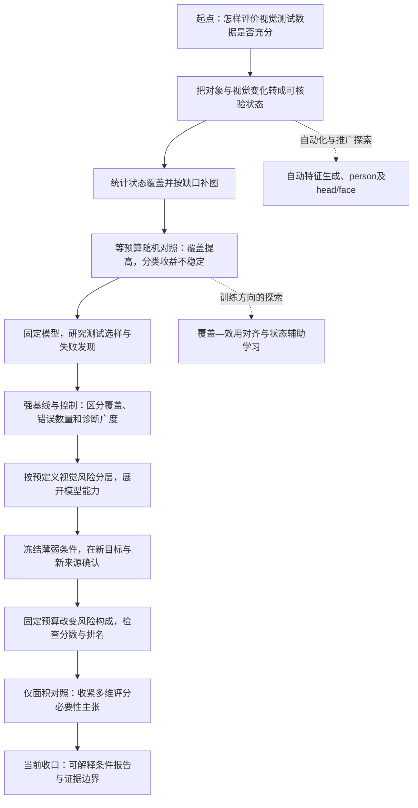

# QE 研究思想演变与路线复盘

整理日期：2026年10月9日。研究档案范围：2026年9月初至10月9日，合并后的 `/home/hcf/project/QE`。

这条研究路线最稳定的核心，是追问：**一个视觉模型的总体分数很好，是否只是因为测试集没有充分呈现它的薄弱条件？我们能否用可解释的视觉状态，说明测过什么、还缺什么、模型在什么条件下不可靠？**

文件呈现的演变可以概括为：从宏观的“测试数据充分性”构想出发，先把视觉状态做成可计算的覆盖指标，尝试通过补图验证价值；发现覆盖增长没有稳定转化为分类收益后，回到固定模型的测试组织；再通过强基线、风险分层、新样本与新来源确认、尺度对照，逐步把贡献收敛到**范围明确的条件化能力诊断**。

本文复盘的是文件中可追溯的研究问题和决策变化，不推测个人心理。部分材料是方案评审、助手整理或汇报建议，不能将其中所有措辞都当作你亲自提出的观点。下文标为“思想变化”的内容是基于档案的归纳；标为“实验观察”的内容对应已有结果。日期主要依据文档正文、协议登记和结果记录，文件名日期不总等于最后更新日期。

## 1. 扫描范围与阅读方式

本次建立全文与章节索引的材料包括：

- `docs` 中95份 Markdown 文档，包含历史归档版本。
- `artifacts` 一级目录及常见 `analysis`、`audit` 子目录中的259份 Markdown 实验说明、结果与证据记录，排除工作区搬迁备份。
- 216份 Python/Shell 文件，用于识别实验入口、方法关系与实施范围；未对全部算法做逐行正确性审计。
- 16份 JSON 配置，以及 README、Git 提交历史和关键结果 CSV。

在索引基础上，重点精读需求说明、主实验方案、转折期结果、主张—证据表、最新论文和最新限制说明。模型权重、图片和重复的 Word/PDF 没有逐个展开；与 Markdown 对应的版本以文字稿为主要阅读对象。本次没有重跑大型实验，也没有进行新的外部文献查新。

## 2. 一张图看整条路线

这不是每一步严格串行的执行日志。训练、选样、状态可靠性和论文整理在一些时间段并行推进；图中顺序表示问题之间的解释关系。

| 时段 | 主要追问 | 思路如何变化 |
| --- | --- | --- |
| 9月初—9月10日 | 总体分数能否说明测试充分？难度与覆盖如何定义？ | 从宏观框架收窄到可解释、可核验的输入条件 |
| 9月11—14日 | 能否把图片变成稳定的状态表，并指出缺口？ | 建立对象、规则、标注、覆盖和补样的工程闭环 |
| 9月15—19日 | 补足状态是否让分类模型更好？ | 引入训练比较、随机补图和覆盖梯度，发现收益非单调 |
| 9月20—21日 | 固定模型后，覆盖选样是否更有测试价值？ | 从分类性能改善转向失败发现与诊断充分性 |
| 9月22—29日 | 是否跨类别成立？是否只是优化自己的评价指标？ | 增加共享状态、留出状态、独立错误指标和等错误数控制 |
| 9月28日—10月5日 | 视觉条件能否稳定区分能力，薄弱条件能否复现？ | 推进风险分层、六类扩展、双标注来源与独立确认 |
| 10月5—7日 | 差异来自风险构成、随机分组，还是简单尺度因素？ | 固定预算风险混合、随机划层、消融和仅面积对照 |
| 10月7—9日 | 哪些主张能留下，怎样交给别人检查和使用？ | 收口为条件诊断实证研究，完善复算与工程交付 |

## 3. 第一阶段：你最初关心的是测试证据，而不只是模型分数

早期需求文件已经提出一个很具体的问题：同样都是犬类图片，测试集可能主要是正面、清楚、无遮挡的目标，却没有覆盖背向、局部可见等条件。类别数量足够，不等于类别内部的视觉变化得到充分测试。

当时的 DTA 构想范围较大，涉及分布、几何、语义、长尾、边界等维度。9月8日的评审开始把四件事拆开：分布代表性、支持域覆盖、故障检出能力和风险估计精度。它们可以相关，却不能由一个归一化总分自动同时保证。

同期还存在“原图难度评分”探索：根据固定模型组的正确性和校准概率形成候选分数。记录指出离散评分区分度不足、校准证据不够，当前不适合直接宣布正式易中难分组。这是一个并行探索方向。后期使用视觉状态与元数据定义风险、不读取分类器错误的路线，与这种模型输出驱动的评分应分开理解。

**这一阶段的思想变化，是先把“充分”拆成可以被证据检验的问题，再选择一个可落地的对象状态切口。** 早期需求将近期工作收窄为“特征规则—模型标注—核验—分布统计—已知缺口对照”，完整充分性理论仍是长期目标。

依据：[具体任务与预期效果](/home/hcf/project/QE/docs/视觉测试数据充分性研究_具体任务与预期效果_20260908.md)、[DTA设想评估](/home/hcf/project/QE/docs/dta_deep_analysis_20260908.md)、[原图难度评分证据边界](/home/hcf/project/QE/docs/difficulty_claim_evidence.md)。本文只复盘这些文件怎样影响研究定位，不重新为其引用的外部论文作真实性背书。

## 4. 第二阶段：把抽象的视觉变化做成可以计算的状态空间

以 dog 为首个案例，你将研究落到固定目标框、原图/框标记图/放大裁剪图、有限枚举特征和冻结规则上。头部朝向、身体可见性、遮挡、截断等变化不再只是示例，而成为逐图可记录、逐状态可计数的对象。

这一阶段的重要进展是建立状态频数与覆盖指标，并把缺失、稀疏、偏少状态转成候选选图依据。它使“应该补哪些图”具有可追溯的理由，不再只是凭整体观感判断数据多样性。

同时，文件逐渐把不同模型的角色分清：数据集提供类别真值；VLM提供视觉描述；被测分类器提供行为结果。早期的独立类别判断实验与后期允许类别信息的状态描述协议，也不能混为一种识别准确率证明。

**这一阶段留下的核心资产，是一套状态描述与证据组织语言。** 覆盖指标是这套语言的统计结果；结构化响应合法、覆盖指数提高，都不能单独证明状态语义正确或模型识别更好。

依据：[犬类特征方案v1](/home/hcf/project/QE/docs/dog_feature_pipeline_plan_v1.md)、[v3.1主张证据表](/home/hcf/project/QE/docs/dog_v3_1_claim_evidence.md)、[自动类别与特征流水线](/home/hcf/project/QE/docs/auto_feature_workflow.md)。

## 5. 第三阶段：尝试用训练收益验证覆盖价值，遇到第一次关键反证

9月15日的主流程方案将两条结果线并列：一条是补图前后的视觉覆盖，另一条是在相同测试集上比较模型训练前后的性能。之后加入等预算随机补图、多模型、多种子和连续覆盖阶段，希望回答“按缺口补图是否比随便增加同样数量的图更有用”。

这里，你尝试用训练结果作为覆盖方法实际价值的一种验证。它是最初测试充分性目标中的一个探索分支，不能把整个项目的起点改写成“为了提高分类准确率”。

**关键实验观察：在跨数据集补图的七个预算点等权平均后，缺口组相对随机组的覆盖优势为7.74个百分点，但 Macro-F1 平均差为−0.19个百分点，dog F1为−0.60个百分点。** 这三个数分别来自覆盖比较表和性能比较表，并非在单个最有利预算点上挑选的结果。

这个结果支持“更高效地补齐定义内状态”，没有支持“普遍提高分类性能”。档案也保留局部收益和架构差异，但没有将某个覆盖峰值写成通用最优点。域偏移、模型容量和稀有状态吸收能力等解释仍是候选机制，不能从这组比较直接确定。

这一时期出现了 CUA-VSL 分支：将状态缺口与验证错误联合起来，并探索覆盖感知采样、状态辅助学习。它说明你曾尝试解决“覆盖怎样变成训练效用”。现有证据表仍把关键增益列为未验证，不能把完整设计稿当成已完成方法。

**第一次重要收缩是：覆盖改善与训练效用必须分别证明。** 后续路线没有继续把所有实验都绑在“F1必须提高”的要求上。

依据：[第一阶段主流程方案](/home/hcf/project/QE/docs/dog_phase1_mainline_experiment_protocol_20260915.md)、[随机补图对照完整分析](/home/hcf/project/QE/artifacts/coco_openimages_random_gradient_8_models_20260918/analysis/gap_vs_random_analysis.md)、[覆盖比较原表](/home/hcf/project/QE/artifacts/coco_openimages_random_gradient_8_models_20260918/analysis/coverage_comparison.csv)、[性能比较原表](/home/hcf/project/QE/artifacts/coco_openimages_random_gradient_8_models_20260918/analysis/performance_comparison.csv)、[CUA-VSL方案](/home/hcf/project/QE/docs/coverage_utility_aligned_visual_state_learning_plan_20260918.md)、[该分支证据状态](/home/hcf/project/QE/artifacts/openimages_v7_cua_vsl_v1/claim_evidence.md)。

## 6. 第四阶段：回到固定模型测试，认识覆盖效率与失败发现的距离

9月20日前后的实验开始固定训练数据和模型权重，只改变测试样本的选择。同预算下，研究目标变成：覆盖驱动方法是否能测到更多视觉状态，是否能发现更广的失败状态，以及这些收益是否跨类别成立。

这里有一个评价视角的变化。训练研究希望提高同一测试条件下的模型表现；测试研究希望获得更有信息的能力证据。冻结模型面对更难的测试集时分数降低，并不意味着模型被训练坏了，但分数降低本身也不足以证明测试策略更好。

早期 dog 与 Random 的某些预算点出现有利结果，cat也显示覆盖效率收益。随后引入 DeepGini、DSA、k-center 等更强对照，并以整个预算曲线的失败状态广度为主比较。结果显示：在当时 dog/cat 设置中，Coverage 的状态覆盖更高，却没有稳定优于强基线的失败发现能力。

**第二次关键收缩是：优化自己的覆盖指标，不等于比其他方法更会找错。** 局部预算点的收益需要保留为局部证据，不能替代整条预算曲线和强基线比较。Coverage的模型访问条件与部分对照不同，也需要明确说明，而不能隐去比较结果。

依据：[9月20日下一阶段方案](/home/hcf/project/QE/docs/semantic_test_adequacy_next_stage_plan_20260920.md)、[强基线比较结果](/home/hcf/project/QE/artifacts/semantic_test_selection_baselines_20260920/semantic_baseline_analysis_zh.md)、[当时结果汇报口径](/home/hcf/project/QE/docs/current_results_reporting_20261005.md)。最后一个文件虽于10月5日整理，主要复盘截至9月20日的结果，不应直接代表10月7日的最终结论。

## 7. 第五阶段：从单一案例走向更公平的诊断证据

9月下旬，你开始同时追问推广与评价公正性。

推广方面，dog之外出现cat、person、head/face，以及后来完整目标的共享状态协议。head/face具有局部区域粒度，person是人体目标；主协议后来明确将face扩展与完整目标多类别主实验分开。这说明你逐渐意识到，增加类别之前要先保证分析对象和指标语义可比。

评价方面，研究不再只用“被Coverage选择的状态里出现了多少失败”作结论，而加入了几种更严格的检查：

- 留出一组状态，仅用其余状态选样，再在留出组评价，降低选样与评价共享状态定义的循环性。
- 以混淆类型和错误目标的表征簇作为额外指标，检查信息是否超出原状态计数。
- 按真实类别匹配错误数量，检查广度收益是否只是因为某方法选到了更多错误图片。
- 在同预算下研究Coverage作为补充信号，是否比随机补充更有用，是否能超过完整强基线。

结果支持了一些相对随机的增量价值，但没有建立对完整强基线的普遍净优势。表征簇也只能作为失败多样性的代理，不能当作独立bug的根因数量。

**这一阶段的思想变化，是从“结果看起来更丰富”推进到“排除简单解释后，额外信息还剩多少”。** “模型无关”主要约束选样信号，不能据此声称整个分析完全不使用分类器输出或表征。

依据：[多类别完整目标协议](/home/hcf/project/QE/docs/multiclass_object_coverage_protocol_20260928.md)、[跨状态留出结果](/home/hcf/project/QE/artifacts/cross_state_decoupled_diagnostics_20260928/report_zh.md)、[增量诊断与互补实验](/home/hcf/project/QE/artifacts/coverage_incremental_value_20260929/report_zh.md)。

## 8. 第六阶段：将“覆盖到了什么”扩展为“在这些条件下表现如何”

9月28日的诊断方案开始把覆盖与视觉难度明确分开：遮挡、可见性、截断、朝向和目标尺度形成预定义风险，而分类器错误只用于后续验证。按类别内部划层，使高低层比较不被类别比例直接解释。

随后加入car，形成dog、cat、horse、sheep、person、car六类任务。六分类模型重新训练完成后冻结，后续风险测试不继续改变权重。早期五分类24份权重与后期六分类24份权重属于不同实验阶段，不能直接混用预测或相减F1。

最终的风险层是类别与候选池内部的相对层级。Q5表示按这套规则排序靠后的高风险目标，不能解释成跨所有任务通用的“最难”等级。unknown保留并进入敏感性分析，也没有被简单当作低风险。

这一时期另一个重要变化，是把发现与确认分开。在发现池A中识别薄弱条件，提前冻结175条状态—架构组合，再带着同一清单到新目标和新来源检查。没有根据确认池的新结果不断替换有利条件。

| 确认池 | 作用 | 目标数 | Q1−Q5平均Macro-F1差：本地 / 线上状态 |
| --- | --- | ---:| ---:|
| B：COCO | 新目标确认；来源已在项目中使用 | 2,400 | 25.50 / 21.30个百分点 |
| C：VOC2007 | 外部来源确认 | 600 | 16.57 / 14.44个百分点 |
| D：Objects365 | 更大外部来源确认 | 2,400 | 41.80 / 41.25个百分点 |

表中按主分析的unknown中点规则报告，数值来自原始结果表。它说明高低风险层在这些设置中有明确平均差距，不要求中间层逐层严格下降，也不证明所有薄弱条件都迁移成功。VOC的许多具体状态支持不足；不可评价与“没有风险”是不同结论。

**第三次收敛是：从构造一个分数，推进到产生能够提前登记、带到新数据检查的测试条件。** 这比事后从错误图里挑几个有说服力的案例多了一层确认逻辑。

依据：[早期递增诊断协议](/home/hcf/project/QE/docs/visual_state_progressive_difficulty_diagnostic_protocol_20260928.md)、[car六分类扩展协议](/home/hcf/project/QE/docs/sixclass_car_extension_protocol_20261004.md)、[COCO新目标结果](/home/hcf/project/QE/artifacts/sixclass_independent_confirmation_20261004/report_zh.md)、[VOC外部结果](/home/hcf/project/QE/artifacts/sixclass_voc_external_confirmation_20261005/report_zh.md)、[Objects365外部结果](/home/hcf/project/QE/artifacts/objects365_independent_confirmation_20261005/report_zh.md)、[高低层与尺度比较原表](/home/hcf/project/QE/artifacts/scale_only_confirmation_20261007/tables/summary.csv)。

## 9. 第七阶段：控制测试构成，再用简单基线挑战方法必要性

### 9.1 固定数量，只改变高风险比例

累计测试集同时改变数量、覆盖与风险构成，容易使解释混在一起。后期因此固定120个目标、每类20个，只改变Q5占比，按0%到100%的21个实际比例点观察冻结模型。

六个“确认池×标注来源”组合的平均Macro-F1终点差介于−12.29至−34.77个百分点。这是100%高风险减0%高风险的差；0%组来自Q1—Q4，不是只取Q1，所以不能与上一节Q1−Q5层差混用。

这条实验线支持的是：**测试条件构成改变时，同一模型的测得能力和部分相对名次也会改变。** 它操纵的是高风险占比，不能改写为“覆盖增加造成F1下降”的单因素因果实验。

依据：[固定预算风险混合结果](/home/hcf/project/QE/artifacts/controlled_risk_distribution_20261005/report_zh.md)、[终点差原表](/home/hcf/project/QE/artifacts/controlled_risk_distribution_20261005/tables/distribution_contrasts.csv)。

### 9.2 追问：是否只用目标大小就足够？

最新阶段最重要的挑战来自仅面积对照。直接根据官方框面积与原图面积的比例排序，不调用VLM，也能形成明显的高低层性能差距。

| 池与标注来源 | 五维评分Q1−Q5 | 仅面积Q1−Q5 | 五维减面积 |
| --- | ---:| ---:| ---:|
| COCO，本地 | 25.50 | 23.38 | +2.12 |
| COCO，线上 | 21.30 | 23.38 | −2.08 |
| VOC，本地 | 16.57 | 10.95 | +5.62 |
| VOC，线上 | 14.44 | 10.95 | +3.48 |
| Objects365，本地 | 41.80 | 43.89 | −2.09 |
| Objects365，线上 | 41.25 | 43.89 | −2.64 |

单位均为百分点。六项多重比较校正后，没有正增量通过；Objects365中仅面积更强的两项差获得校正支持。因此，大幅F1落差本身不足以证明VLM或多维评分的必要性，也不能据此建立其普遍成本收益优势。

你随后进一步追问尺度之外的条件信息：在类别内部的面积五分位层中，比较冻结状态与同字段已知非状态。COCO的119个可评价组合中109个仍为Recall负差，Objects365的122个中111个为负；VOC只有4个可评价，2个为负。

这为部分非尺度条件提供了更具体的关联证据。不过面积五分位不是精确尺度匹配，状态会共现，组合也会重叠，不能将109或111写成独立软件缺陷数量。

**第四次收缩是：方法的价值需要落在具体诊断信息上，不能只靠一条陡峭的曲线证明。** “小目标表现差”可以由便宜元数据揭示；“哪些姿态、可见性或背景条件值得进一步测试”则是状态报告尝试提供的更细信息。

依据：[尺度对照原表](/home/hcf/project/QE/artifacts/scale_only_confirmation_20261007/tables/summary.csv)、[面积层内条件比较原表](/home/hcf/project/QE/artifacts/scale_only_confirmation_20261007/tables/area_condition_summary.csv)、[最新局限性说明](/home/hcf/project/QE/docs/局限性_20261007.md)。上述负差计数已在本次扫描中从原表按`evaluable=True`重新汇总。

## 10. 第八阶段：把研究成果收口为条件报告与可检查资产

最新论文将主要问题定为风险分层区分、固定预算风险构成响应，以及可复现薄弱条件和诊断广度的价值边界。这里已经形成相对稳定的贡献结构：状态协议组织输入条件，风险分层展开模型能力，分类行为评价实际表现，冻结条件在新池确认。

论文、优点与局限性同步更新，配套真实输入案例、结果表、便携复算包与核验入口。10月9日的整合记录又将“缓存可以复算”“抽样真实推理可以对齐”“全部历史服务和模型能够从零重建”分开，不把工程检查通过升级成完整科研有效性证明。

**这一阶段的思想变化，是将“我做出了很多结果”进一步转成“别人能检查哪些结论、使用哪些报告、哪些信息仍缺失”。** 当结果变成持续可查的条件清单和回归测试资产，测试价值才有较明确的交付形态。

依据：[最新中文论文](/home/hcf/project/QE/docs/visual_state_testing_journal_zh_20261007.md)、[复现入口说明](/home/hcf/project/QE/docs/复现入口说明_20261007.md)、[整合后试运行记录](/home/hcf/project/QE/docs/整合后试运行记录_20261009.md)。整合记录只覆盖其明确列出的检查范围；它没有宣称全池重推理或重新验证VLM。

## 11. 哪些探索分支应该保留在复盘里

| 分支 | 当时想解决的问题 | 与当前主线的关系 |
| --- | --- | --- |
| 基于固定模型组的原图难度分数 | 能否对输入的识别困难程度排序 | 早期探索；与后期不读取分类错误的视觉风险评分不同 |
| CUA-VSL、覆盖感知训练 | 怎样将状态缺口变成训练收益 | 提出完整机制设计，但关键收益仍未被当前证据表确立 |
| 自动类别判断与schema生成 | 特征字典能否减少人工定制 | 工具与推广探索；不能自动证明生成状态适合科学评价 |
| head/face与新基础模型 | 能否推广到不同对象粒度和模型 | 独立扩展；不与完整目标六类任务直接合并统计 |
| Coverage与强基线混合 | 是否存在互补性 | 有相对随机补充的局部证据，未确立普遍超过纯强基线 |
| 状态组合与错误图谱 | 能否描述更具体的失败形式 | 诊断探索；联合条件高错误率不等于已确定交互或因果根源 |

这些分支说明路线不是单线推进。部分探索留下了工具，部分留下了负结果或边界，部分仍是待验证方案。它们不能统称为失败，也不能统称为已经完成的创新贡献。

## 12. 贯穿整个项目的思想与发生改变的判断

### 12.1 始终保留的三个核心

第一，**研究对象始终包含测试数据本身。** 你关心的不只是模型总分，而是这个分数建立在什么输入条件和证据量上。

第二，**你选择了一种可解释的外部表示。** 与其只给出“这张图很特殊”的分数，项目不断尝试把它展开为对象尺度、朝向、可见性、遮挡、截断和背景等可描述条件。

第三，**你希望描述能够导向行动。** 最初是按缺口补图，后来是选择测试样本、冻结薄弱条件、在新来源确认，最终是向测试者说明下一步应该继续检查什么。

### 12.2 在证据推动下改变的判断

| 早期希望或容易混淆的判断 | 文件中的修正依据 | 当前可保留的表述 |
| --- | --- | --- |
| 覆盖更高，模型应该更好 | 等预算训练补图收益不稳定 | 覆盖与训练效用分别报告 |
| 更高状态覆盖就是更有效测试 | 强基线在失败发现上并未被稳定超过 | 覆盖效率、失败发现、条件解释分别验证 |
| Coverage后续批次会越来越难 | 独立批次错误率不是单调变化 | 覆盖顺序与风险顺序分开定义 |
| 多找到错误就多找到不同缺陷 | 状态重叠、错误数量影响广度 | 使用等错误数与额外指标，保留代理性质 |
| 高低风险F1落差证明多维评分必要 | 连续面积已有强区分度 | 进一步检验状态描述的条件诊断信息 |
| 双VLM一致说明标签正确 | 官方部分属性参考与一致子集支持有限 | 自动状态可靠性仍有独立证据缺口 |
| 新池没有足够状态样本说明风险不存在 | VOC多项条件不可评价 | 证据不足与未复现分开记录 |
| 工程检查通过说明理论和方法成立 | 文档持续区分结构、复算、语义与科学效用 | 每类主张由相应证据支持 |

这张表是本报告的综合归纳，不是对你原话的逐字引用，也不意味着你曾将左列所有判断明确作为结论。

## 13. 对你当前研究定位的判断

基于最新档案，你当前最有证据支持的定位是：

> **在已知目标框的六分类任务中，用自动、可解释的视觉条件组织冻结模型测试，展开总体指标背后的条件能力差异，确认部分可迁移的薄弱条件，并明确覆盖选样与风险评分的增量价值和限制。**

这条表述包含三个证据层次。

| 层次 | 当前证据状态 | 可以怎样表达 |
| --- | --- | --- |
| 风险构成与条件能力差异 | 在已测确认池和模型面板中有支持 | 不同视觉风险构成对应明显测得性能差异；简单面积也有强区分能力 |
| 薄弱条件的跨池确认 | 支持充分的池中有部分确认，稀疏池有边界 | 某些自动协议定义的条件可用于提出进一步测试需求 |
| Coverage的额外选样价值 | 条件性支持，受基线、控制和校正口径限制 | 某些设置有增量诊断收益，普遍优越性未确立 |

尚不能把当前项目写成“普适充分性标准”“自动状态全部正确”“风险因素的因果解释”“普遍最佳测试选样算法”，也没有证据把五维风险评分称为普遍优于仅面积。

最新材料没有新增完整人工状态真值复核。文档记录人工分支后来未进入当前执行范围，因此不能继续把最早的双人复核计划写成已经完成。双标注来源、官方部分字段参考和敏感性分析能提供不同层次的检查，但不替代语义真值验证。

依据：[无人工复核补强方案](/home/hcf/project/QE/docs/visual_state_automatic_strengthening_protocol_20261005.md)、[最新论文的贡献与讨论](/home/hcf/project/QE/docs/visual_state_testing_journal_zh_20261007.md)、[局限性与最终收口](/home/hcf/project/QE/docs/局限性_20261007.md)。

## 14. 可以怎样讲述自己的思想路线

下面是一段基于上述档案整理的第一人称叙述，可作为汇报草稿；它不是聊天或录音原话。

> 我最初关心的是视觉测试数据是否充分：一个模型的总体分数很好，是否只是因为我们测到的场景比较有限。
>
> 为了让这个问题可计算，我先从犬类目标开始，将朝向、可见性、遮挡、截断等视觉变化变成固定状态，再统计覆盖和缺口，并尝试按缺口补图。
>
> 后来我通过等预算随机对照发现，补图能够提高状态覆盖，但没有稳定提高分类F1。这让我把覆盖改善和模型效用拆开，也把主要问题重新放到测试上：固定模型以后，这些状态能否帮助我们获得更有用的能力证据。
>
> 在测试选样中，我继续加入强基线和更严格的控制。结果提醒我，测到更多状态不一定更会找错，发现更多错误也不一定意味着发现了更多不同问题。因此，我加入状态留出、等错误数和独立错误指标，检查额外诊断信息。
>
> 随后我将视觉条件用于风险分层，并把发现池中的薄弱条件冻结下来，到新目标和新数据来源确认。这样，我的目标逐渐从一个覆盖总分，走向能够说明模型在什么条件下薄弱的测试报告。
>
> 最新的仅面积对照又表明，简单元数据已经可以产生很大的分层差异，所以我不能只靠F1落差证明VLM必要。我现在更关心状态描述能否提供具体、可复查的测试条件，以及哪些关联在调整尺度构成后仍然存在。
>
> 当前我将工作定位为范围明确的测试实证研究：报告测过的条件、模型的条件能力和部分可复现的薄弱点，同时保留自动标签、简单基线、稀疏支持与推广范围的限制。

## 15. 下一步沿着现有路线可以继续追问什么

以下是本次复盘提出的后续问题，不表示现有实验已经完成，也不修改你的当前论文主张。

1. **条件报告是否实际改变测试决策？** 给测试者相同预算，比较有无状态报告时提出的测试条件、发现的新问题及复核成本。这将直接检验报告用途。
2. **状态描述带来的信息是否值得其成本？** 在同一信息访问和预算下，将“仅面积”“面积加少量状态”“完整状态”比较，明确收益与标注负担。
3. **哪些状态语义足以支撑诊断？** 若未来接受人工核验，应优先核验贡献最大的条件；若继续保持自动方案，应明确条件由自动协议定义，并检验诊断对合理标签扰动的敏感性。
4. **冻结薄弱条件能否成为稳定回归测试需求？** 在新采集目标、不同预处理或新的模型版本上持续确认，检查它们能否复用，避免把新池重新变成调参集。
5. **“证据还不够”能否成为报告的正式输出？** 把低支持、unknown、来源分歧和不可评价条件明确列出来，使报告不仅展示薄弱点，也指导下一轮收集什么证据。

从档案归纳，你的主问题已经逐步变得具体：**如何把一个平均测试分数，展开成有条件、有证据量、有复现边界、能指导后续测试的能力报告。**
