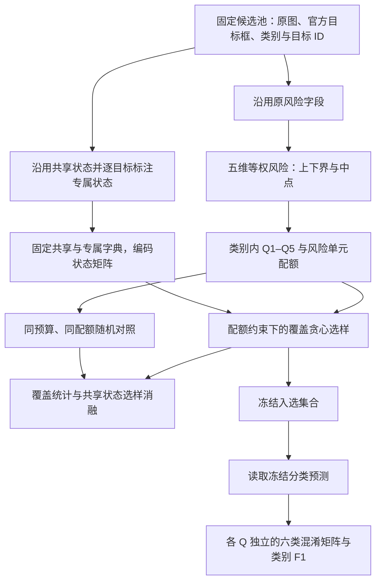

# 风险构成受控的视觉状态覆盖与模型诊断实证研究

> **全自动扩展更新**：按最新要求，本轮不安排人工环节。已完成严格复现阈值、种子一致性、风险层内可比性和条件去重分析；结果见[全自动诊断稳健性报告](/home/hcf/project/QE/docs/全自动诊断稳健性实验结果_20261018.md)。人工语义准确率未测量，不作为当前执行前置条件。

> **补充实验更新（2026-10-18）**：强基线、独立预算/阈值/权重敏感性、800目标外部状态复核与80目标重复标注已完成。主预算下相对稀缺度的支持收益仅0.04–0.59个百分点，出现覆盖相同；全状态诊断方向复现44条，少于k-center的47条。人工准确率仍待补。详细设置、正负结果与表格见[补充实验报告](/home/hcf/project/QE/docs/覆盖与诊断补充实验结果_20261018.md)。下文原实验数值保留其历史口径。

方法说明：以视觉状态覆盖率和支持完成度为主要覆盖指标，在固定风险配额内选样，并分析模型的分层表现与诊断边界。

版本：2026-10-18。依据项目“最新实验结果汇总_20261018”中的四类专属特征实验、冻结配置和实际执行代码整理。正文说明当前方法，附录记录与最新结果的对应关系；不将早期实验中的其他评分规则或验证流程并入本版。

本研究关注：**在测试预算和规定风险构成相同的条件下，视觉状态覆盖引导能否提高覆盖率与样本支持，类别专属状态带来哪些增量与取舍，以及这些测试集合如何用于观察模型表现和诊断其边界？** 方法先描述目标的视觉状态，再固定风险构成，在约束内补充覆盖，最后评价冻结模型。类别专属特征用于扩展覆盖空间，风险评分沿用固定规则。

研究主线为：**视觉状态表示 → 风险配额控制 → 覆盖引导选样 → 覆盖率与支持完成度评价 → 模型分层表现和诊断分析。** 覆盖既是选样的依据，也是主要研究对象；其与诊断价值的关系需要单独检验，不预设覆盖越高就一定测得越好。

阅读建议：初次接触项目时，先读第 1 节的问题、例子与三个研究问题，再结合第 5–7 节理解选样和评测；讲解实验时使用附录 C 的“问题—对照—指标—回答”。未知分量和整数配额的计算细节集中在附录 D。

## 1. 问题设定与方法输出

### 1.1 为什么需要组织测试样本

设想需要从已有图像中选择 200 个马目标测试分类模型。如果入选目标大多清晰、完整且朝向相近，测试数量虽然不少，也可能缺少某些遮挡、朝向或外观状态的样本支持。这是本研究希望处理的情形示例，不是对当前候选池分布的预先判断。

我们用可观察的视觉属性描述目标，并把“字段及其取值”称为一个**视觉状态**，例如“身体朝向为背向”。一个目标可以同时支持多个状态。选择测试样本时，既关心哪些状态至少出现过，也关心每个状态已有多少样本。

同时，增加状态支持的选样过程可能改变测试目标的风险构成。如果一种方法恰好选择了更多遮挡或截断目标，就难以区分覆盖差异与风险构成变化。为此，本方法用固定规则组织风险层，并规定各风险单元选多少目标，在这些配额相同的条件下比较选样策略。

最后，模型在各风险层分别接受测试，得到按视觉条件组织的性能报告。这里的“风险”是根据目标尺度、可见性、遮挡、截断和朝向预定义的分数；它是否对应模型表现差异，需要由评测回答，不能在定义时直接认定。

| 概念 | 通俗含义 | 在方法中的作用 |
|---|---|---|
| 测试预算 | 允许选择多少个目标 | 固定比较规模，本轮每类 200 个 |
| 视觉状态 | 一个可观察属性的具体取值 | 描述测试涉及哪些视觉条件 |
| 状态支持数 | 有多少入选目标具有该状态 | 区分“出现过”与“有一定数量的测试样本” |
| 覆盖 | 状态出现和支持数量的汇总 | 指导选样并评价样本构成 |
| 风险层 Q1–Q5 | 按预定义风险排序得到的五组 | 组织评测条件；从相对低风险到相对高风险 |
| 风险单元配额 | 对同层、同分数、同不确定性的目标规定名额 | 使选样方法具有相同的规定风险构成 |
| 类别 F1 | 综合该类漏判及其他类误入的分类指标 | 评价固定模型在各风险层的表现 |

### 1.2 现有实验回答的三个研究问题

本研究把风险、覆盖和诊断放在同一个实验框架中，但分别定义它们的作用：

| 研究要素 | 核心问题 | 具体量及比较方式 |
|---|---|---|
| 风险构成控制 | 不同选样方法是否在规定的相同风险构成下比较？ | 固定预算、类别比例和风险单元配额；选样方法之间匹配 |
| 视觉状态覆盖 | 哪些状态被测到，各有多少目标支持？ | 出现覆盖率、支持完成度；相对随机及共享状态选样的变化 |
| 模型诊断 | 模型在哪些条件下表现较弱，结论依据是否充分？ | 独立 Q 层 F1、具体状态的性能与支持量；进一步检验新数据上的复现 |

“风险构成受控”适用于比较选样策略；比较 Q1 与 Q5 时，风险条件本身就是有意改变的因素。不能把两类实验都描述成“风险完全相同”。同时，本文严格区分覆盖率与支持完成度：前者描述状态出现比例，后者描述支持数量，二者均是主要结果，不混称为同一个百分比。

以下研究问题用于组织已有实验的讲解与写作，不将本次整理表述为实验前的预注册。每个主问题对应一种不同的比较，避免只展示曲线而没有明确判断对象。

| 研究问题 | 具体要回答什么 | 对应实验与指标 |
|---|---|---|
| **RQ1：相同预算和风险单元配额下，覆盖引导能否提高视觉状态覆盖率与支持完成度？** | 覆盖选样是否优于不使用覆盖信息的选样 | 扩展字典贪心对比 1000 组同配额随机集合；出现覆盖率、支持完成度 |
| **RQ2：增加类别专属状态如何改变共享与专属覆盖率、支持完成度及其取舍？** | 新增字典是否实际改变选样并补充类别细节 | 扩展字典贪心对比仅共享状态贪心；两者在同一完整字典下评价，报告共享/专属覆盖与支持、目标替换数 |
| **RQ3：预定义视觉风险分层是否对应不同的模型分类表现？** | 风险组织是否具有当前模型上的诊断意义 | 固定模型在各独立 Q 层的类别 F1；Q1/Q5 端点差及中间回升情况 |

讲解时还可以展开两个有直接证据的追问：**RQ2a：专属支持的提高是否伴随共享支持的损失？** 以及 **RQ3a：Q1 到 Q5 的性能变化方向是否在多个模型上都出现？** 这两个追问分别解释选样取舍和模型间一致性，属于 RQ2、RQ3 的深化，不必包装成两个独立贡献。

三个主问题承担不同角色：RQ1 评价覆盖选样的收益，RQ2 解释专属字典的增量作用，RQ3 描述风险分层与模型表现的关系。RQ3 中 F1 下降不能替代 RQ1、RQ2 的覆盖对照，也不能用来宣称模型性能得到提升。

完整实证研究还应包含一个连接覆盖与诊断的后续问题：**RQ4：在同预算、同风险配额下，覆盖率与支持完成度的变化，是否对应更多可独立验证的薄弱条件，在哪些情况下不对应？** 原四类主实验回答了前三个问题的限定版本；本次补充实验已对 RQ4 进行了回顾性外部检验，但人工准确率和前瞻外部验证仍未完成。当前覆盖图和分层 F1 图不能拼接成“覆盖增加导致诊断更好”的证据。后续应比较选样策略所发现条件的新数据复现情况；结果可以是正向、无差异或存在取舍。

### 1.3 用一个例子理解选样

下面是说明机制的假设例子，不是实际实验样本。假设当前有两个马目标 A、B，二者位于同一个仍有剩余名额的风险单元，其他状态的边际贡献也相同。

| 比较项 | 目标 A | 目标 B |
|---|---|---|
| 可见鬃毛状态 | 悬垂 | 编束 |
| 当前已选集合对该状态的支持 | 20 例 | 0 例 |
| 增加目标后的支持 | 21 例 | 1 例 |
| 该状态带来的选样收益 | 已达饱和阈值，不再增加收益 | 首次支持该状态，产生正收益 |

在这些假设下，方法优先选择 B。两者的风险单元相同，替换不改变规定的风险构成，却为尚未覆盖的状态增加了样本。这就是“在风险配额内补充覆盖”的含义。

选择 B 不意味着模型一定会认错 B，也不意味着编束鬃毛比悬垂鬃毛更难识别。方法在选样时没有读取模型预测；它只是根据当前状态支持决定哪一个目标更值得加入测试集合。实际每个目标支持多个状态，算法将它们的边际贡献相加后比较。

### 1.4 输入、约束与输出的正式定义

前面的例子对应一个明确的选择问题：给定已有目标及视觉状态、固定每类预算和各风险单元名额，从候选中选出能够增加状态支持的目标集合，然后用冻结模型评价该集合。下面的符号用于准确表达这些对象。

设候选池为

$$
\mathcal D=\{(u_i,I_i,b_i,y_i)\}_{i=1}^{N},
$$

其中，$u_i$ 为唯一目标 ID，$I_i$ 为原始图像，$b_i$ 为官方目标框，$y_i$ 为官方类别标签。分类输入为对应目标裁剪图。测试单位是一个已定位目标，本轮评价的是六分类任务，不评价目标框定位或检测召回。

用 $S_c$ 表示从类别 $c$ 中选出的目标集合。状态支持是选择时希望增加的量，各风险单元名额是必须满足的约束，模型 F1 是选样完成后才计算的评价结果。

当前候选池包含狗、猫、马、羊、人和汽车，每类 400 个目标，共 2400 个。各类内部构造五个风险层，每层 80 个候选；每类最终选择 200 个目标，每层 40 个。六类合并后的测试集包含 1200 个目标。

最新一轮对马、羊、人、汽车共 1600 个目标补充类别专属状态标注，并据此重新选样。狗、猫保留此前仅由共享状态驱动的选样结果，作为六类共同评测的一部分。因此，本版属于“四类专属扩展、六类共同评测”，不能表述为六类均完成同一版专属特征扩展。

方法输出包括：目标级结构化状态及其证据、风险上下界与分层、风险单元配额、入选目标清单、状态支持与覆盖指标，以及逐模型、逐种子、逐风险层的混淆矩阵和类别 F1。覆盖选样过程不读取分类器预测、置信度或错误标签；分类结果在选样冻结后用于评测。

整体过程为：



## 2. 视觉状态字典与目标级标注

### 2.1 字典的组织层级

字典按五个大类组织：空间几何、可见性与完整性、外观与形态、朝向与姿态、场景与图像质量。它们用于组织描述字段，**并非风险评分中的五个维度**。风险维度另定义为尺度、可见性、遮挡、截断和朝向。

一个字段包含有限个允许取值；一个“字段—取值”组合构成一个覆盖状态。例如，“被毛花纹—条纹”和“被毛花纹—纯色”是两个状态。单选字段每个目标只取一个值，多选字段可以支持多个状态，同一目标对同一状态最多贡献一次。

共享部分固定为 15 个字段、71 个已知状态。字段包括目标尺度、身体可见性、身体朝向、遮挡程度、遮挡物类型、截断程度、群体关系、交互关系、场景、背景复杂度、模糊、照明、目标背景对比、可识别性和呈现形式。其中尺度由官方框和原图尺寸计算，其余共享状态复用已有标注。

类别专属部分在共享字典之外增加具有类别含义的描述。例如，马的鬃毛和异色斑，羊的被毛、角和耳廓，人的衣着、发型和鞋类外观，以及汽车的灯具、格栅和轮辋形态。

| 类别 | 专属字段数 | 专属已知状态数 | 共享状态数 | 当前覆盖字典状态总数 |
|---|---:|---:|---:|---:|
| 马 | 15 | 73 | 71 | 144 |
| 羊 | 13 | 62 | 71 | 133 |
| 人 | 15 | 73 | 71 | 144 |
| 汽车 | 13 | 57 | 71 | 128 |

完整字段、取值和操作判据见[当前字典目录](/home/hcf/project/QE/results/最新实验结果汇总_20261018/05_特征字典/当前确认版)。字段数不要求各类别相同，覆盖分母也随类别字典而异。

### 2.2 风险输入与覆盖输入分离

这种分离使 RQ2 的对照可以保持同一套风险配额：加入更多描述字段会改变覆盖选择的依据，但不会同时改写“什么目标被分到高风险层”。

风险输入沿用冻结的原始字段；覆盖输入由冻结共享状态和本轮新增专属状态组成。即使新增字段与旧风险字段名称接近，例如头部可见性或头部朝向，新标注也不覆盖原风险输入。

对类别 $c$，覆盖状态全集记为

$$
\mathcal U_c=\mathcal U^{\mathrm{shared}}\,\dot\cup\,\mathcal U_c^{\mathrm{specific}}.
$$

这里的并集保留命名空间，实际状态标识为“命名空间—字段—取值”，避免共享和专属状态混写。新增字段均为 `coverage_only`，风险权重为零。

$\mathcal U_c$ 在选样前固定，不根据某次入选集合重新生成。专属字典中所有非 `unknown` 枚举状态均保留，即使候选池没有观察到，也仍计入覆盖分母。这使同一类别内不同选样方法使用相同统计口径。

### 2.3 逐目标自动标注

本轮专属标注使用本地 `qwen3-vl:30b-a3b-instruct`。每次请求只对应一个目标，输入一张并排证据图：左侧为带目标红框的原图，右侧为同一官方目标的裁剪。原图用于判断上下文和原图截断，裁剪图用于查看局部外观。裁剪边缘本身不能作为原图截断的证据。

模型依据已确认的字段定义和枚举判据，输出具名字段 JSON。提示要求只描述指定目标的可见证据，不借用邻近目标的信息，不依据类别常识补全隐藏部位，也不推断品种、身份或情绪。看不清、未显示或无法区分的属性记为 `unknown`；“无法观察”与“确认不存在”分开处理。

程序检查字段集合、值类型、枚举合法性、多选去重和排他规则。`unknown` 不与其他取值共存；字典规定的其他排他值也按规则校验。保存原始响应、解析结果、证据图与字典及图像哈希，以绑定目标身份和输入版本。结构校验通过仅说明输出形式合规，不等于语义标注正确。

最终实验采用 `independent-named-v2` 协议。首轮多目标数值编码试跑因出现不可见属性被猜测的现象，已排除在正式统计之外。用户确认的是字段定义和取值，当前没有逐图人工真值，也未测量标注准确率或人工一致性。

## 3. 固定五维风险评分与不确定性表示

本节回答怎样组织视觉条件，为 RQ1、RQ2 提供共同配额，也为 RQ3 提供待检验的风险分层。先定义评分，再观察模型表现，避免根据错误结果反向挑选分层规则。

### 3.1 风险的含义与尺度

风险分数是预定义的视觉条件组织指标，用于分层和控制选样构成，不是分类错误概率。当前采用 `equal_parts` 规则，五个维度各占 20%，综合分数范围为 0–100。

先把每个维度的分数换算到 0–1，再各乘 20 后相加，就是最终用于排序的风险中点。设各维度的中点分数为 $r_{i,d}$，则核心计算为

$$
\bar R_i=20\bigl(r_{i,\mathrm{scale}}+r_{i,\mathrm{visibility}}+
r_{i,\mathrm{occlusion}}+r_{i,\mathrm{truncation}}+r_{i,\mathrm{orientation}}\bigr).
$$

字段都已知时直接按下表赋分；包含未知信息时先保留区间，再使用中点，见第 3.2 节。

目标尺度来自原图中的目标框面积占比：

$$
a_i=\frac{w_i h_i}{W_i H_i},
$$

其中 $w_i,h_i$ 是官方框宽高，$W_i,H_i$ 是原图宽高。尺度分数使用原图面积占比，不使用裁剪缩放后的尺寸。

各基础字段先映射到 $[0,1]$：

| 字段 | 当前风险映射 |
|---|---|
| 目标尺度 | $a<0.01$：1；$0.01\le a<0.03$：2/3；$0.03\le a<0.10$：1/3；$a\ge0.10$：0 |
| 头部可见性 | `clear`：0；`partial`：1/2；`not_visible`：1 |
| 肢体可见性 | `all_expected`：0；`some`：1/2；`one`：3/4；`none`：1 |
| 身体整体可见性 | `full`、`most`：0；`partial`：2/3；`minimal`：1 |
| 遮挡程度 | `none`：0；`light`：1/3；`moderate`：2/3；`heavy`：1 |
| 截断程度 | `none`：0；`light`：1/4；`moderate`：1/2；`heavy`：1 |
| 身体朝向 | 正向、左右侧向、斜向：0；背向：1/2；俯视或非常规视角：1 |
| 头部朝向 | 正向、左右侧向：0；背向：1/2；朝上或朝下：1 |

非汽车类别的可见性维度由原头部可见性、原肢体可见性各占一半构成；朝向维度由原身体朝向、原头部朝向各占一半构成。汽车的可见性采用原身体整体可见性，朝向采用原身体朝向。尺度、遮挡和截断分别使用对应基础字段。

例如，在字段均已知时，非汽车目标的可见性维度为

$$
r_{i,\mathrm{vis}}=\tfrac12 r_{i,\mathrm{head}}+\tfrac12 r_{i,\mathrm{limb}}.
$$

新增鬃毛、衣着、灯具等属性没有经过本轮风险赋分；它们通过覆盖选样发挥作用。所有分值和权重均沿用冻结配置，没有根据本轮 F1 曲线调整。

### 3.2 未知分量保留上下界

如果某个风险分量看不清，就不能把它当作“没有风险”，也不能假定它一定是最困难状态。本方法让该分量保留从 0 到 1 的可能范围，并保留原权重；不会删除未知分量后给其余分量重新分配权重。

把未知分量都取低端，得到综合风险下界 $R_i^-$；都取高端，得到上界 $R_i^+$。两端平均得到排序中点 $\bar R_i$，两端之差得到不确定性宽度 $\omega_i$。直观上，一个数记录“按什么位置排序”，另一个数记录“这个位置还存在多大未确定范围”。中点不是对真实风险的统计期望；完整分量公式见附录 D.1。

例如，非汽车目标的头部可见性已知为 `clear`、肢体可见性未知时，可见性维度区间为 $[0,0.5]$，对总风险贡献区间 $[0,10]$，中点贡献为 5。只统计“未知维度个数”会丢失这一分量权重信息，因此本版按实际区间宽度控制不确定性。

当前选样保留每类全部 400 个候选，不因包含未知分量而缩减为完整观测子集。风险中的未知区间与覆盖中的未知排除是两种用途：前者保留不确定性，后者不把未知当作已观察到的状态。

## 4. 类别内风险分层与固定配额

对每个类别分别按 $(\bar R_i,u_i)$ 升序排序，即先按风险中点，同分时按目标 ID，随后五等分为 Q1–Q5。类别 $c$ 中第 $q$ 层的目标集合记为 $Q_{c,q}$。每层包含 80 个目标，Q1 和 Q5 分别表示本类别内相对低风险和相对高风险。它们不是跨类别统一的绝对难度阈值；同分目标也可能因五等分边界落入相邻层。

仅固定每层样本数，仍可能让不同方法选择不同风险中点或不同不确定性的目标。因此，在类别内部进一步定义联合单元

$$
g_i=(q_i,\bar R_i,\omega_i),
$$

其中 $q_i$ 为风险层编号。例如，两个目标可能都在 Q3，但一个风险中点更高，或其分数存在更大未知范围。将这些情况分开规定名额，可避免某种选样策略在 Q3 内偏选其中一类。下文也用 $g$ 表示该单元的目标集合。

每层共选 40 个目标，各单元按候选数量比例分配整数名额，记为 $b_g$。例如，某单元占该层一半候选，就分得 20 个名额。比例计算不能整除时，先取整数，再按余数分配剩余名额；精确计算和数值处理见附录 D.2。

本轮沿用此前冻结的风险规则与配额，校验新旧风险上下界、中点和 Q 归属完全对应。扩展覆盖选样、随机对照和旧共享状态选样最终均满足

$$
|S_c\cap g|=b_g,\qquad |S_c\cap Q_{c,q}|=40,\qquad |S_c|=200.
$$

配额控制的是联合单元构成，不保证单元内所有视觉属性、图像背景或未知字段身份也相同。

## 5. 固定风险配额下的覆盖贪心选样

### 5.1 状态支持矩阵

可以把状态矩阵理解为一张勾选表：一行是一个目标，一列是一个状态，具有该状态就记 1，否则记 0。选中若干行后，把每一列相加，就知道该状态得到多少个测试目标支持。

对类别 $c$，将候选目标和固定字典编码为二值矩阵

$$
X^{(c)}\in\{0,1\}^{400\times|\mathcal U_c|},\qquad
X^{(c)}_{is}=\mathbf1\{\text{目标 }i\text{ 被标注为状态 }s\}.
$$

若某字段为 `unknown`，该字段对应的已知状态列均不获得支持。单选字段的已知取值贡献一列，多选字段可贡献多列。对已选集合 $S_c$，状态支持数为

$$
n_{c,s}(S_c)=\sum_{i\in S_c}X^{(c)}_{is}.
$$

### 5.2 截断对数增益

选样采用“优先补少、达到上限后停止奖励”的原则。某状态第一次获得样本时收益较大，已有较多样本后再增加一例的收益较小，达到 20 例后该状态不再产生额外收益。对数函数负责逐步降低收益，截断负责设定上限；它们构成选样偏好，不表示已经证明 20 例足以可靠评价任意状态。

设支持饱和阈值为 $\tau=20$。选样使用截断对数目标

$$
F_c(S_c)=\sum_{s\in\mathcal U_c}\log\bigl(1+\min(n_{c,s}(S_c),\tau)\bigr).
$$

新增一个目标 $i$ 的边际增益为

$$
\Delta(i\mid S_c)=
\sum_{\substack{s\in\mathcal U_c\\n_{c,s}(S_c)<\tau}}
X^{(c)}_{is}\left[\log(n_{c,s}(S_c)+2)-\log(n_{c,s}(S_c)+1)\right].
$$

该增益使已有支持较少的状态获得更大边际贡献；达到 20 例后，该状态不再增加选样收益。覆盖目标按状态等权，不按字段或五大字典组再次均衡。因此，枚举状态较多的字段和可贡献多个取值的字段可能具有更大的选样影响；共享与专属语义相近的状态也不会自动合并去重。

### 5.3 可行候选、并列规则与停止条件

初始 $S_c=\varnothing$，各状态支持数和单元已用配额为零。每轮只考虑尚未入选、且所在单元仍有剩余配额的目标，选择边际增益最大者。增益并列时按目标 ID 选取最小者，数值判定细节见附录 D.3。

**当前实现每轮在所有仍有配额的风险单元中共同比较候选，不按 Q1 到 Q5 逐层执行贪心。** 状态支持数在本类别整个已选集合上累计。每加入一个目标，就更新其状态支持数与所在单元已用配额，直到选满 200 个。即使剩余最大增益为零，也继续按配额和并列规则补满预算，避免不同方法因提前停止而出现样本量差异。

```text
对每个需要扩展的类别 c：
    S ← 空集；状态支持 n ← 0；单元已用配额 used ← 0
    重复 200 次：
        feasible ← 未选目标中满足 used[g(i)] < b[g(i)] 的目标
        根据当前 n 计算各 feasible 目标的截断对数增益
        i* ← 最大增益目标；并列按目标 ID
        将 i* 加入 S，更新 n 与 used[g(i*)]
    核对每个单元配额、每层 40 个目标与总数 200
```

这是对覆盖目标的约束贪心实现，不宣称求得全局最优解。其选样增益与下一节报告的线性支持完成度定义不同，不能将两者混为同一目标函数。

## 6. 覆盖评价、随机对照与消融

### 6.1 三种互补的覆盖指标

这三个指标分别回答“有多少状态测到过”“各状态离 20 例支持目标还有多远”“有多少状态已达到 20 例”。每个状态贡献先单独计算，再在固定字典内平均；不能用指标名称中的“完成”推断测试已经充分。

对类别 $c$ 的同一固定字典，分别计算：

**出现覆盖率**：至少出现一次的状态比例。

$$
C_c^{\mathrm{presence}}(S_c)=\frac{1}{|\mathcal U_c|}
\sum_{s\in\mathcal U_c}\mathbf1\{n_{c,s}(S_c)>0\}.
$$

**支持完成度**：每个状态相对 20 例支持目标的完成比例，再对状态平均。

$$
C_c^{\mathrm{support}}(S_c)=\frac{1}{|\mathcal U_c|}
\sum_{s\in\mathcal U_c}\min\left(\frac{n_{c,s}(S_c)}{20},1\right).
$$

**达到支持阈值的状态比例**：已获得至少 20 例的状态比例。

$$
C_c^{\mathrm{threshold}}(S_c)=\frac{1}{|\mathcal U_c|}
\sum_{s\in\mathcal U_c}\mathbf1\{n_{c,s}(S_c)\ge20\}.
$$

例如，一个状态获得 10 例时，已经贡献出现覆盖，对支持完成度贡献 0.5，但尚未达到支持阈值。三个指标不能互换名称。这里统计的是单状态支持，不是全部多属性组合覆盖。

### 6.2 同预算、同风险单元随机对照

随机对照在每个风险单元内无放回抽取对应配额，合并为每类 200 个目标，保留 1000 次重复。本轮直接复用已保存的 1000 组配额匹配随机集合，并逐组重新检查所有联合单元的配额。

随机集合和当前贪心集合均使用本轮完整字典与同一状态标注重新计算覆盖。对任一覆盖指标 $C$，报告

$$
\Delta C_c=C_c(S_c^{\mathrm{expanded}})
-\frac{1}{1000}\sum_{r=1}^{1000}C_c(S_{c,r}^{\mathrm{random}}).
$$

指标转换成百分数后，上式差值以百分点表示。该比较回答“在同预算、同风险单元配额下，覆盖引导能增加多少状态支持”。随机分布的 2.5%–97.5% 分位区间表示这批随机选样的波动范围，不能自动解释为数据集总体置信区间或显著性检验。

### 6.3 仅共享状态选样消融

保留旧的 71 状态贪心入选集合，与当前“共享＋专属”字典驱动的入选集合比较。两者预算与风险单元配额相同，并使用**同一本轮完整字典**重新评价。分别报告总覆盖、共享部分覆盖、专属部分覆盖及被替换的目标数量，以区分新增专属支持和已有共享支持之间的取舍。

不能把旧图中的 71 状态覆盖率与新图中的 128–144 状态覆盖率直接相减；它们的分母已经改变。

### 6.4 按风险层累计展示覆盖

当前覆盖曲线使用最终入选集合的嵌套子集

$$
S_{c,\le k}=\{i\in S_c:q_i\le k\},\qquad k=1,\ldots,5,
$$

相应目标数为 40、80、120、160、200。每个点均沿用完整固定字典，不按当前层重定义分母；随机对照也按相同方式累计。

这些子集是对最终选样结果按 Q 过滤得到的，不是每个预算下重新运行一次贪心所得的最优或独立解，也不是贪心实际选取顺序的前缀。固定字典下，累计支持数及上述覆盖指标必然非下降；曲线向上本身不能证明算法有效，效益应由同预算、同配额对照判断。

## 7. 冻结模型预测下的分层性能评价

### 7.1 各层六类共同评测

对每层 $q$，把六类该层各 40 个入选目标合并为

$$
T_q=\bigcup_{c=1}^{6}\{i\in S_c:q_i=q\},\qquad |T_q|=240.
$$

Q1–Q5 分别独立评测，不累计先前层的目标。与覆盖曲线不同，F1 曲线的每个点使用独立的 240 个目标。

本轮读取 YOLO26s、PE-Core-B16、SigLIP2-Base、MobileCLIP2-S0、AIMv2-Large 五个模型各三个种子的冻结预测。读取时按目标 ID 对齐 2400 个目标，核对真值标签、六类 logits 的形状及有限性，再由最大 logit 得到类别预测。没有重新训练或重新执行分类器推理；新增推理仅发生在专属状态自动标注阶段。

### 7.2 类别 F1 与聚合顺序

以马为例，既要统计有多少马被正确识别，也要统计有多少其他类别被误判成马。因此必须把六类目标放在同一个评测集合中，再从混淆矩阵计算马的 F1。只看马目标上的正确比例，无法得到这里使用的类别 F1。

对模型 $m$、种子 $t$、风险层 $q$，构造六类混淆矩阵 $H^{m,t,q}$，行表示真实类别，列表示预测类别。对类别 $c$：

$$
TP_c=H_{cc},\qquad
FN_c=\sum_jH_{cj}-TP_c,\qquad
FP_c=\sum_jH_{jc}-TP_c,
$$

$$
F1_c^{m,t,q}=\frac{2TP_c}{2TP_c+FP_c+FN_c}.
$$

分母为零时按实现记为零。先在每个种子内由混淆矩阵计算类别 F1，再求同一模型三个种子的均值与标准差。需要跨模型摘要时，再对五个模型的种子均值取算术平均。六类 Macro-F1 则是同一次运行中六个类别 F1 的平均，不等于某一类别 F1，也不通过合并不同种子的混淆矩阵代替逐次计算。

类别 F1 的假阳性来自同层其他五类目标，因此其变化同时反映该类真阳性/假阴性变化及负类误入该类的变化。当前共同分层协议会同时改变正类和负类的视觉条件，不能把类别 F1 的变化完全归因为该类自身风险。

狗、猫虽然保留旧入选集合，它们的类别 F1 仍可能因另外四类负样本集合改变而变化；旧猫类图不应被当成本轮六类混合设置下的同一结果。

### 7.3 趋势解释

风险层用于检验预定义视觉条件与当前模型表现之间的关系，不预先要求相邻层严格递减。报告 Q1、Q5 端点差以及中间层回升情况。三种子标准差描述训练种子间波动，不是目标抽样或数据集总体的置信区间。

F1 下降表明该评测设置中不同风险层对应不同模型表现；它不能单独证明测试集质量更高，不能证明某一属性导致错误，也不能说明覆盖选样改善了模型本身。

## 8. 当前实现的关键设置与复现边界

| 项目 | 当前设置 |
|---|---|
| 数据与任务 | 固定 COCO 目标候选池，六类目标裁剪分类 |
| 候选规模 | 6 类 × 400；新增专属标注为其中 4 类 × 400 |
| 共享表示 | 冻结 15 字段、71 个状态及已有标注 |
| 新增标注 | 本地 Qwen3-VL，逐目标具名 JSON，`independent-named-v2` |
| 标注采样参数 | temperature=0，初始 seed=20261018，num_ctx=16384，num_predict=2000 |
| 标注重试 | 最多 3 次尝试；重试 seed 为初始值加尝试序号减 1，保留原始输出 |
| 风险规则 | `equal_parts`；五维各 20%；未知保留区间，中点排序 |
| 分层与配额 | 类别内五等分；每类选 200，每层 40；精确匹配层、中点、区间宽度联合单元 |
| 选样目标 | 截断对数状态支持增益，饱和阈值 20，按 ID 处理增益并列 |
| 对照 | 已冻结的 1000 组同配额随机集合；旧共享状态贪心集合 |
| 分类模型 | 5 个模型 × 3 个种子，使用冻结预测 |
| 分类种子 | 20260916、20260917、20260918 |
| 性能口径 | 每 Q 六类共同评测；先逐种子计算 F1，再聚合 |
| 覆盖口径 | 对最终集合按 Q1 至 Qk 累计；固定本类完整字典分母 |

完整复现依赖官方原图与裁剪、冻结目标清单、原状态输入、当前字典、选样缓存、分类预测及对应软件环境。归档保存了结果、预测、程序快照和校验信息，但不包含完整 COCO 原图、模型权重或独立运行环境；程序还引用原项目路径。因此，归档可用于追溯和复核统计，不能直接称为可在任意目录独立运行的完整环境包。

当前方法还存在以下明确边界：自动标注误差可能影响覆盖选样；同分按 ID 切层具有确定性但不消除边界任意性；状态等权不等于字段等权；共享与专属状态可能语义相关；只控制指定风险分布不能控制所有视觉因素；固定候选池中的结果不自动推广到新数据源或未测模型。本文不将早期外部验证、双来源一致性或错误广度实验写成本轮已重新完成的工作。

## 附录 A. 最新结果与方法设计的对应

以下数值用于确认本文对应的实验版本，不作为选样调参依据。类别 F1 先按三个种子求模型均值，再平均五个模型；覆盖增益相对于 1000 次同配额随机选样均值。

| 类别 | Q1 类别 F1 | Q5 类别 F1 | 端点下降（百分点） | 出现覆盖增益（百分点） | 支持完成度增益（百分点） |
|---|---:|---:|---:|---:|---:|
| 马 | 87.67% | 64.03% | 23.64 | +3.06 | +5.56 |
| 羊 | 88.76% | 68.90% | 19.86 | +2.46 | +5.76 |
| 人 | 90.76% | 58.61% | 32.15 | +2.65 | +4.85 |
| 汽车 | 94.24% | 73.71% | 20.53 | +1.27 | +5.47 |

四类的两种覆盖指标均高于本类同配额随机对照均值；四类、五模型的 20 条种子均值曲线均为 Q5 低于 Q1，但部分中间层回升。因此，当前结果支持“同配额下增加状态支持”及“风险层之间存在总体性能落差”，不支持“严格单调下降”或未经检验的统计显著性结论。

相对于旧共享状态贪心，四类分别替换 59、42、62、57 个入选目标。专属支持完成度提高，但共享支持完成度分别下降 1.27、0.56、2.39、1.27 个百分点。羊类专属出现覆盖没有增加，其变化主要体现在已有状态的样本支持数量。这说明专属扩展改变了有限预算下的支持分配，不能表述为所有维度都无代价改善。

## 附录 B. 方法陈述与证据索引

下表作为本文的陈述—证据映射。实验事实以最终协议、正式 v2 标注、冻结产物和实际调用代码为准。字典目录中的形成阶段说明仍包含“尚未确认”“尚未批量提取”等历史文字；本轮是否确认及是否完成由最终实验协议和审计记录确定。

| 编号 | 本文陈述 | 直接依据 | 适用边界 |
|---|---|---|---|
| M1 | 四类专属扩展，六类共同评测；每类 400 选 200 | [最终实验协议](/home/hcf/project/QE/results/最新实验结果汇总_20261018/01_四类专属特征最新实验/protocol.json) | 狗、猫保留旧共享选样 |
| M2 | 专属字段仅用于覆盖；风险输入保持冻结 | [风险与覆盖工作配置](/home/hcf/project/QE/results/最新实验结果汇总_20261018/05_特征字典/当前确认版/workflow_config.json)、[风险锁定审计](/home/hcf/project/QE/results/最新实验结果汇总_20261018/05_特征字典/当前确认版/risk_lock_audit.json) | 不把新同名字段替换进旧评分 |
| M3 | 正式标注逐目标执行，失败试跑被排除 | [v2 标注协议](/home/hcf/project/QE/results/最新实验结果汇总_20261018/01_四类专属特征最新实验/annotation_protocol_v2.json)、[正式标注程序](/home/hcf/project/QE/results/最新实验结果汇总_20261018/07_程序与配置/scripts/annotate_other_classes_specific_v2_20261018.py) | 自动语义准确率未测 |
| M4 | 五维等权、分量加权、未知区间及 0–100 评分 | [评分配置](/home/hcf/project/QE/results/最新实验结果汇总_20261018/07_程序与配置/configs/category_five_dimension_pilot_v1.json)、[评分函数](/home/hcf/project/QE/results/最新实验结果汇总_20261018/07_程序与配置/scripts/run_category_five_dimension_pilot.py) | 本文采用 `equal_parts`，非其他历史方案 |
| M5 | 联合风险单元使用中点及实际区间宽度 | [分层与配额构造](/home/hcf/project/QE/results/最新实验结果汇总_20261018/07_程序与配置/scripts/run_coco_fine_coverage_experiment_20261015.py)、[本轮单元配额](/home/hcf/project/QE/results/最新实验结果汇总_20261018/01_四类专属特征最新实验/risk_cell_quotas.csv) | 配额在每层内按最大余数分配 |
| M6 | 所有可行单元共同贪心、对数增益、零增益仍补满预算 | [被调用的 greedy 函数](/home/hcf/project/QE/results/最新实验结果汇总_20261018/07_程序与配置/scripts/run_qe_three_strategy_full_experiment.py)、[本轮调用与统计程序](/home/hcf/project/QE/results/最新实验结果汇总_20261018/07_程序与配置/scripts/analyze_other_classes_specific_experiment_20261018.py) | 历史脚本仅复用相应函数，不继承其其他实验设置 |
| M7 | 覆盖分母、三个覆盖指标及同字典消融 | [状态支持数](/home/hcf/project/QE/results/最新实验结果汇总_20261018/01_四类专属特征最新实验/state_support.csv)、[覆盖汇总](/home/hcf/project/QE/results/最新实验结果汇总_20261018/01_四类专属特征最新实验/coverage_summary.csv)、[累计覆盖](/home/hcf/project/QE/results/最新实验结果汇总_20261018/01_四类专属特征最新实验/coverage_cumulative_Q1_Q5.csv) | 本类同字典比较，累计曲线不是独立重选 |
| M8 | 冻结五模型三种子预测与类别 F1 定义 | [预测审计](/home/hcf/project/QE/results/最新实验结果汇总_20261018/01_四类专属特征最新实验/prediction_audit.json)、[混淆矩阵](/home/hcf/project/QE/results/最新实验结果汇总_20261018/01_四类专属特征最新实验/confusion_matrices.json)、[逐种子 F1](/home/hcf/project/QE/results/最新实验结果汇总_20261018/01_四类专属特征最新实验/model_F1_by_seed.csv) | 共同 Q 负类组成会影响类别 F1 |
| M9 | 附录 A 的数值和共享/专属取舍 | [最终汇总表](/home/hcf/project/QE/results/最新实验结果汇总_20261018/01_四类专属特征最新实验/final_summary.csv)、[原实验陈述与证据](/home/hcf/project/QE/results/最新实验结果汇总_20261018/01_四类专属特征最新实验/claim_evidence.md) | 不作严格单调、因果或显著性声明 |

本次文档核对从四类状态矩阵重新计算了当前选样和 1000 组随机对照的三种覆盖指标，核验了每层数量和各联合单元配额，并从 225 个归档混淆矩阵重新计算类别及 Macro-F1，复核四类 Q1/Q5 的五模型三种子均值，均与归档表一致。本次仅核对和撰写文档，未重新运行状态标注、模型训练或分类推理。

## 附录 C. 用研究问题组织实验与讲解

本附录可以直接作为实验章节或汇报提纲。正文第 1.2 节提出问题，本附录用已有结果回答；证据对应附录 B 的 M7–M9。三个主问题已经有当前实验的直接证据，两个追问用于展开解释，不新增未执行的实验或显著性声明。

### C.1 RQ1：同预算、同风险配额下，能否提高覆盖率与支持完成度？

**提出问题的原因。** 如果覆盖引导只是选择了更多高风险或低风险目标，其收益就可能伴随测试构成改变。因此，需要在风险单元配额一致时，比较使用覆盖信息和不使用覆盖信息的选样。

**怎么做对照。** 每类都选 200 个，且各 Q、风险中点和不确定性宽度的联合单元名额一致。将“共享＋专属”状态驱动的贪心集合与 1000 组随机集合比较。两者使用相同目标标注和相同完整字典分母，分别统计出现覆盖率和支持完成度。

**现有结果怎么回答。** 马、羊、人、汽车的出现覆盖均高于本类随机对照均值，增益为 1.27–3.06 个百分点；支持完成度增益为 4.85–5.76 个百分点。具体数值见附录 A。因而，在当前候选池及自动标注定义下，覆盖引导在固定风险配额内增加了状态支持。

**应展示什么。** 先展示附录 A 的覆盖增益两列，再使用[累计覆盖图](/home/hcf/project/QE/results/最新实验结果汇总_20261018/01_四类专属特征最新实验/四类_Q1-Q5_累计覆盖率.svg)说明不同累计层范围内的覆盖。指出有效证据是与同预算随机对照的差值，不能把累计曲线自然向上作为算法收益。

**一句话讲法。** “在选样数量和规定风险构成相同的情况下，覆盖引导让更多视觉状态获得了样本支持。”

**这还不能回答什么。** 覆盖定义和选样目标相关，这个对照评价的是既定状态表示下的覆盖收益；它没有独立证明发现更多软件缺陷、覆盖全部视觉组合或获得更高的总体测试价值。高于随机均值也不等于已经获得显著性结论。

### C.2 RQ2：类别专属特征如何改变覆盖率、支持完成度及其取舍？

**提出问题的原因。** 共享字段便于统一描述，但没有显式编码所有类别外观细节。仅增加字典条目还不够，需要检验这些条目是否改变了选样，以及是否让专属状态获得更多支持。

**怎么做对照。** 比较“仅共享状态驱动的旧贪心选样”与“共享＋专属状态驱动的新贪心选样”。预算、候选池和风险单元配额相同；两组都用本轮完整字典重新评价。这样比较的是选样依据变化，而不是覆盖分母变化。

**现有结果怎么回答。** 下表从[最终汇总表](/home/hcf/project/QE/results/最新实验结果汇总_20261018/01_四类专属特征最新实验/final_summary.csv)提取，所有变化均为新选样减旧共享选样。

| 类别 | 替换目标数（每类 200 个） | 专属出现覆盖变化（百分点） | 专属支持完成度变化（百分点） | 共享支持完成度变化（百分点） |
|---|---:|---:|---:|---:|
| 马 | 59 | +5.48 | +5.62 | −1.27 |
| 羊 | 42 | +0.00 | +3.47 | −0.56 |
| 人 | 62 | +2.74 | +5.62 | −2.39 |
| 汽车 | 57 | +1.75 | +5.61 | −1.27 |

新增专属状态确实改变了入选目标，四类专属支持完成度均提高。羊类没有增加首次被覆盖的专属状态，但为已有状态补充了支持数量，因此不能把所有收益都说成“发现了新状态”。

**一句话讲法。** “专属特征使选样关注到更多类别细节，其增量体现在实际入选集合和专属状态支持的变化上。”

**这还不能回答什么。** 对照支持整组专属字典的增量作用，尚不能说明每个新增字段都必要，也不能证明当前字典优于其他所有可能字典。更不能把自动标注中的支持增加直接解释为语义标注准确率提高。

### C.3 RQ3：风险分层是否对应不同的模型分类表现？

**提出问题的原因。** 风险规则由可观察视觉属性预先定义，其与模型实际表现的关系需要检验。若不同层呈现性能差异，就能用这套分层描述模型在何种风险条件下表现较弱。

**怎么做评测。** 在每个独立 Q 层合并六类各 40 个目标，使用五模型、各三种子的冻结预测计算类别 F1。观察 Q1 与 Q5 的端点差，同时保留中间层是否回升的信息。这里比较的是同一模型面对不同层的表现，没有要求高风险层一定较差，也没有据此重新调节风险规则。

**现有结果怎么回答。** 五模型均值下，马、羊、人、汽车的 Q1 到 Q5 类别 F1 分别下降 23.64、19.86、32.15、20.53 个百分点。在当前六类共同分层评测中，风险层与模型表现存在总体对应关系，但相邻层并非全部严格递减。

**应展示什么。** 使用[四类五模型 F1 图](/home/hcf/project/QE/results/最新实验结果汇总_20261018/01_四类专属特征最新实验/四类_五模型_Q1-Q5_F1.svg)，先解释每个点使用独立 Q 层，再指出端点落差和中间回升，避免与累计覆盖曲线混读。

**一句话讲法。** “这套预定义风险分层在当前模型上对应明显的端点性能落差，可以组织分层诊断，但不保证每升一层性能都下降。”

**这还不能回答什么。** 各层同时改变正类和负类构成；类别 F1 的变化不能完全归因为该类自身某个属性，也不能解释为遮挡、尺度等单一因素的独立因果作用。当前对照没有证明五维规则优于任意其他评分，也不能据 F1 下降单独宣称测试质量更高。

### C.4 追问 RQ2a：专属支持增加是否伴随共享支持损失？

这个追问紧接 RQ2 的表格即可回答：四类共享支持完成度均下降，范围为 0.56–2.39 个百分点，同时专属支持完成度提高。固定预算下，新增状态参与同一选样目标，会改变支持分配；本轮结果确实体现了这种取舍。

建议表述为：“专属扩展增加了类别细节的样本支持，但部分共享状态支持有所减少。”不表述为所有状态或所有指标同步改善，也不凭这些数值宣布当前共享与专属之间的分配已经最优。

### C.5 追问 RQ3a：性能下降方向是否只出现在个别模型上？

查看[逐模型趋势表](/home/hcf/project/QE/results/最新实验结果汇总_20261018/01_四类专属特征最新实验/F1_trends.csv)中的 `expanded` 结果：四类与五模型构成的 20 条三种子均值曲线全部为 Q5 低于 Q1。这说明端点下降方向出现在本轮全部五个模型中，并非仅由某一个模型拉低平均值。中间层回升仍然存在。

这是一项当前模型集合内的描述性一致性结果。不能将其扩写成所有模型都会下降、各训练种子均严格单调，或对未知模型的泛化保证；它也没有消除多个模型共享相同测试数据带来的依赖。

### C.6 推荐的讲解顺序

1. **从一个具体测试困境开始。** “同样测试 200 个目标，数量相同不代表视觉条件支持相同。”用第 1.3 节的假设例子解释状态和支持。
2. **解释两个需要分开的量。** 覆盖告诉我们“测到了什么、各有多少样本”，风险告诉我们“按怎样的视觉条件组织和约束测试”。随后介绍固定配额内选样。
3. **用 RQ1 证明定义下的覆盖收益。** 展示同预算、同配额随机对照，回答算法是否实际增加状态支持。
4. **用 RQ2 解释专属字典的作用，并回答 RQ2a。** 展示新旧选样消融，同时呈现专属收益与共享损失。
5. **用 RQ3 说明模型诊断结果，并回答 RQ3a。** 展示逐模型 F1 曲线，解释总体端点下降和非单调现象。
6. **给出证据范围。** 结论落在当前候选池、字典、自动标注和五模型设置；标注准确率、独立缺陷发现及外部数据推广仍需要对应证据。

可用下面一段话连接整项工作：

> 我们研究风险构成受控条件下的视觉状态覆盖与模型诊断。首先在固定测试预算和风险配额内，使用共享与类别专属状态引导选样，评价状态出现覆盖率和支持完成度；随后分析类别专属扩展带来的覆盖增量与共享支持取舍，并观察固定模型在不同风险层的表现。当前结果支持同配额下的覆盖收益，也显示覆盖分配存在代价。覆盖收益是否进一步对应更可靠的薄弱条件诊断，是需要独立验证的关系，而不是由覆盖率或 F1 曲线直接推出的结论。

### C.7 当前不宜作为“已回答”的研究问题

| 暂不宜宣称已经回答的问题 | 当前证据缺少什么 |
|---|---|
| 方法是否提高了分类器准确率？ | 本轮固定模型且不训练；不同测试集合上的指标变化不等于模型改进 |
| 方法是否发现了更多独立缺陷或更有价值的错误？ | 本轮覆盖与 F1 不能替代独立缺陷定义及相应对照 |
| 自动视觉状态标注是否准确、优于人工或其他标注器？ | 本轮未提供逐目标人工真值和准确率对照 |
| 五维等权、对数增益与支持阈值 20 是否最优？ | 当前固定设置不等于已完成权重、目标函数和阈值的系统消融 |
| 覆盖收益是否普遍适用于其他数据集和任意模型？ | 当前四类扩展结果不能替代新的外部数据与模型验证 |
| 覆盖曲线能否说明小预算独立选样最优或标注成本下降？ | 曲线按最终集合累计过滤，本轮还标注了全部四类候选；未完成相应预算重选或成本实验 |

## 附录 D. 保留用于复现的计算细节

### D.1 未知分量的区间聚合

设维度 $d$ 内的基础分量为 $j$，固定分量权重为 $\alpha_{dj}$，满足 $\sum_j\alpha_{dj}=1$。已知分量映射值记为 $r_{idj}$，未知分量保留可能区间 $[0,1]$。维度下界、上界和中点为

$$
L_{id}=\sum_{j\in\mathrm{known}}\alpha_{dj}r_{idj},\qquad
U_{id}=L_{id}+\sum_{j\in\mathrm{unknown}}\alpha_{dj},\qquad
M_{id}=\frac{L_{id}+U_{id}}{2}.
$$

第 3.1 节中的 $r_{i,d}$ 即这里的 $M_{id}$。综合风险为

$$
R_i^-=100\sum_d0.2L_{id},\qquad
R_i^+=100\sum_d0.2U_{id},\qquad
\bar R_i=\frac{R_i^-+R_i^+}{2},\qquad
\omega_i=R_i^+-R_i^-.
$$

固定分量权重不因未知而改变，不确定性按实际区间宽度保留。

### D.2 联合单元与整数配额

实现将风险中点和区间宽度乘 $10^8$ 后四舍五入为整数键，再与 Q 编号组成联合单元，避免浮点表示造成单元不一致。

设某层单元 $g$ 有 $N_g$ 个候选，该层预算为 40。该单元的理想配额为

$$
\widetilde b_g=40\frac{N_g}{\sum_{h:q_h=q_g}N_h}.
$$

先取整数部分，再按小数余数从大到小分配剩余名额；余数相同时按单元键排序。实际实现用整数分子及余数计算，保留数学上相等的余数关系。每层最终配额和恰为 40，各单元配额不超候选容量。

### D.3 贪心并列判定

边际增益差在绝对容差 $10^{-12}$ 内视为并列，相对容差为零，再按目标 ID 选取最小者。所有仍有剩余配额的单元共同参与候选比较；即使最大增益为零，也继续补满共同预算。
