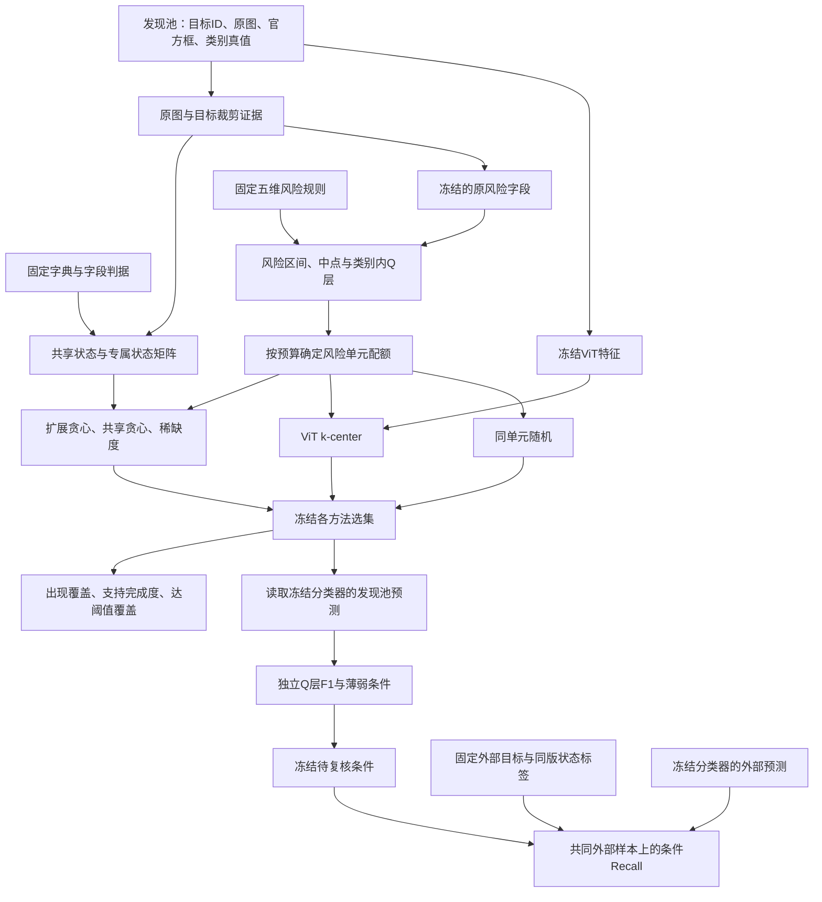

# 风险构成受控的视觉状态覆盖与模型诊断实证研究

**英文题目：** An Empirical Study of Visual-State Coverage and Model Diagnostics under Controlled Risk Composition

**作者与单位：** 待填写  
**版本：** 中文初稿 v0.1，2026-10-18

## 摘要

在有限预算下组织视觉模型测试，既需要关注测试涉及哪些视觉条件，也需要关注每种条件具有多少样本支持。然而，不同选样策略可能同时改变目标尺度、遮挡和截断等条件的构成，使覆盖差异与风险构成变化混杂；覆盖指标的提高也不必然对应更有效的模型诊断。本文围绕这两个问题开展实证研究。我们以已定位目标的六分类任务为对象，使用共享与类别专属字典描述视觉状态，根据冻结的五维规则构造风险分数及其不确定性，并在相同预算和风险单元配额下比较扩展状态贪心、共享状态贪心、静态稀缺度、视觉特征 k-center 与随机选样。实验覆盖四类共1600个发现目标、五个既有分类模型及三个训练种子，并使用800个 Objects365 目标进行回顾性外部复核。主预算为每类200个目标时，扩展贪心的状态支持完成度高于同单元随机均值4.85–5.76个百分点，但相对静态稀缺度仅高0.04–0.59个百分点，且两者的状态出现覆盖率在四类上均相同。加入专属状态提高了专属支持，同时降低了部分共享支持。五个模型在四类上均表现出Q5端点F1低于Q1的现象，但中间风险层并非严格单调。全状态诊断主分析中，扩展贪心提出的59条条件有44条在外部样本上复现负方向，15条支持不足；k-center复现47条。进一步的探索性风险层内比较中，扩展贪心提出的条件均未达到预定可比性要求。结果表明，在当前自动标签和数据范围内，受控风险构成下的状态覆盖选样可以改善样本支持；这一收益尚不足以确立诊断优势，也不能解释为状态的独立因果作用。

**关键词：** 视觉模型测试；视觉状态覆盖；风险构成控制；测试集选择；模型诊断；实证研究

## 1 引言

假设测试者需要从现有图像中挑选200个马目标，评价一个已经训练完成的分类模型。样本数量相同，并不意味着测试内容相同：一个集合可能包含较多清晰、完整且朝向相似的目标，另一个集合则可能包含更多外观、姿态和场景条件。仅报告整体分类指标，难以说明哪些条件已获得测试，哪些条件只出现过一次，以及哪些条件仍缺乏足够样本。

本文将一个可观察字段及其具体取值称为一个**视觉状态**，例如“身体朝向—背向”。同一个目标可以同时支持多个状态。“某种状态出现过”与“该状态具有足够的测试样本”也需要区分：一次出现可以填补覆盖空白，却未必足以支持稳定的条件性能估计。因此，本文同时考察状态出现覆盖率、支持完成度与达阈值覆盖率。

利用输入特征组织机器学习测试已有研究基础。Cody等通过组合交互测试刻画与选择机器学习数据[1](https://arxiv.org/abs/2201.12428)；Aghababaeyan等研究了黑盒输入多样性与错误发现能力的关系[2](https://arxiv.org/abs/2112.12591)。关于覆盖能否代表测试有效性，已有研究也指出需要考虑覆盖类型、评价目标和应用场景，不能将二者直接等同[3](https://arxiv.org/abs/2010.04946)。本文在这一背景下，进一步考察可解释视觉状态的覆盖与模型诊断之间的联系。

这一考察存在两个需要明确处理的问题。首先，覆盖选样可能改变测试集合的风险构成。例如，一种方法选择了更多被遮挡目标，其错误数量增加，既可能与覆盖有关，也可能只是因为集合更难。本文使用固定的尺度、可见性、遮挡、截断和朝向评分构造风险单元，使不同方法在同一预算下满足相同的单元配额。这里控制的是预定义代理分数的构成，其有效范围需要与真实错误概率区分。

其次，状态支持增加是否会带来更多能够复核的薄弱条件，需要单独检验。某种方法可能较好地分配了状态支持，却未发现更多外部可复现条件；另一种方法可能状态覆盖较低，但恰好包含了更有诊断价值的样本。为此，本文将覆盖评价、风险分层表现和外部条件复核分别设计为独立分析，避免用一张分层性能曲线代替对测试选择有效性的验证。

本文以马、羊、人和汽车为主要研究类别。在六分类模型保持冻结的条件下，比较五种选样策略，并开展预算、支持上限、字段权重、随机字段缺失与外部诊断稳健性分析。本文的贡献包括：

1. 给出一个风险构成受控的视觉状态测试组织方案，明确区分输入状态、代理风险、覆盖支持和模型评价，建立可追溯的选样与分析过程。
2. 在固定候选池、字典和风险配额下，量化状态覆盖收益及共享与专属状态之间的取舍，并纳入静态稀缺度和视觉多样性基线，界定当前贪心策略的实际增量。
3. 通过回顾性外部复核、复现幅度、种子一致性和条件去重分析，报告覆盖收益与诊断结果不一致的情形，以及风险层内比较缺乏可比样本的限制。

本文主要提供上述条件下的实证证据。其结果不涉及通过选样重新训练分类器，也不将风险评分解释为真实错误概率。

## 2 相关工作

### 2.1 输入覆盖与测试集多样性

覆盖可以围绕模型内部行为构建，也可以围绕输入及输出特征构建。Cody等利用从输入和输出提取的特征开展组合覆盖分析，展示了这种描述用于训练集与测试集组织的方式[1](https://arxiv.org/abs/2201.12428)。本文采用显式字段及取值作为描述单位，当前指标统计单个状态的出现与支持，没有评估多字段取值组合的交互覆盖。因此，本文的“状态覆盖”不应被理解为完整的组合交互覆盖。

Aghababaeyan等将图像特征多样性作为黑盒测试信号，研究其与错误发现的关联[2](https://arxiv.org/abs/2112.12591)。本文引入预训练ViT特征的k-center作为视觉多样性对照，但该实现是配额约束下的基线，不是对该论文完整方法的复现。两类描述各有侧重：显式状态便于解释覆盖内容，特征距离能够描述未被当前字典显式列举的视觉差异。本研究通过共同预算与风险配额比较其结果，没有将两者的计算成本视为相等。

### 2.2 覆盖与测试有效性的关系

Yan等从测试有效性视角重新研究多种覆盖指标，报告了结构与非结构覆盖之间的互补关系及适用场景[3](https://arxiv.org/abs/2010.04946)。TEASMA进一步研究如何使用充分性指标建立针对特定模型的错误检测率预测过程[4](https://arxiv.org/abs/2308.01311)。这些研究表明，覆盖指标应当结合明确的有效性目标进行评价。

本文不把覆盖率直接转换为测试充分性保证，而是观察所选集合能否提出具有足够支持、且能够在外部样本上复核的条件。本文也没有建立覆盖指标到错误发现率的预测模型。其关注点是：当规定的风险构成保持一致时，状态覆盖的变化与条件诊断之间是否存在一致的收益。

### 2.3 可解释薄弱切片与语义覆盖

Domino使用跨模态嵌入和错误感知混合模型发现并描述性能薄弱的数据切片[5](https://arxiv.org/abs/2203.14960)。本文的条件空间由事先固定的字典给出，选样阶段不读取待测分类器输出；选样冻结后，才在这些状态中筛选条件性能较低的条目。这使本文更接近“测试组织之后的受限条件诊断”，而非开放式切片发现。当前实验未直接运行Domino，因而不能声称优于切片发现方法。

较近的工作也将语义条件用于测试规划。Aich等提出SliceScorer与SliceNav，结合覆盖暴露和邻近失败信号推荐驾驶VLM的待测切片[6](https://arxiv.org/abs/2606.01624)。Hashemi等使用VLM识别语义条件，并通过生成式增强补充测试集中的语义缺口[7](https://arxiv.org/abs/2610.13697)。本文研究已有目标池中的预算选择，使用冻结的共享与专属状态，并显式匹配风险单元配额；没有使用失败信号驱动覆盖选样，也没有生成新测试图像。

因此，可解释状态、语义覆盖和薄弱条件诊断均已有相近研究。本文的定位集中在当前目标分类设置下的受控比较与混合结果分析，不主张首次提出语义覆盖或覆盖与有效性需要区分的观点。

## 3 问题定义

### 3.1 测试对象与输入条件

研究对象是**已定位目标的图像分类测试**。设候选池为

$$
\mathcal D=\{(u_i,I_i,b_i,y_i)\}_{i=1}^{N},
\tag{1}
$$

其中，$u_i$为唯一目标标识，$I_i$为原图，$b_i$为官方目标框，$y_i$为官方类别真值。目标框和原图尺寸共同确定目标裁剪以及原图中的目标面积占比。分类器接收目标裁剪图，输出六个类别中的一个。本文不评价目标检测定位质量或检测召回率。

这一输入有明确前提：图像可读取，目标ID唯一，目标框有效，类别属于冻结的任务类别，并具有对应的官方类别标注。方法以包含这些字段的目标清单及关联图像作为起点，使用已有定位和类别信息开展风险计算与有监督分类评价。

除目标池外，方法还接收冻结状态字典、风险规则、每类预算及选样配置。待测分类器在选样结束后参与评价，其预测、置信度及错误标签不进入状态覆盖贪心目标。

### 3.2 视觉状态与支持数

对类别$c$，冻结状态空间记为

$$
\mathcal U_c=\mathcal U^{\mathrm{shared}}
\,\dot\cup\,\mathcal U_c^{\mathrm{specific}}.
\tag{2}
$$

共享状态描述各类别共同使用的条件，专属状态描述类别相关的可见外观。实际状态标识为“命名空间、字段、取值”三元组。同名字段出现在不同命名空间时仍为不同状态。以$z_{is}\in\{0,1\}$表示目标$i$是否被标注为具有状态$s$。单选字段通常支持一个已知状态，多选字段可以支持多个；同一目标对同一状态只计一次。

对入选目标集合$T_c$，状态支持数为

$$
n_s(T_c)=\sum_{i\in T_c}z_{is}.
\tag{3}
$$

例如，$n_s=1$表示该状态已经出现，$n_s=20$表示已有20个目标支持该状态。未知取值不作为已观察状态计入支持；冻结字典中的合法已知状态即使没有在当前候选池出现，也保留在覆盖分母中。不同类别的字典大小不同，本文重点比较同一类别内的方法差异。

### 3.3 选择问题与研究问题

给定每类预算$b$，从候选池中选择$T_c$，使$|T_c|=b$，同时满足所有风险单元的固定配额。在这些约束下，增加状态支持并评价集合内容；之后利用冻结分类器分析风险分层表现及条件性能。

| 研究问题 | 比较对象 | 主要观察量 |
| --- | --- | --- |
| RQ1：相同预算和风险配额下，状态覆盖选样能否提高覆盖与支持？ | 扩展贪心与随机、稀缺度及k-center | 出现覆盖率、支持完成度、达阈值覆盖率及预算敏感性 |
| RQ2：增加类别专属状态带来什么增量与取舍？ | 扩展贪心与共享贪心 | 共享和专属指标变化、入选目标替换数 |
| RQ3：预定义风险分层是否对应模型表现差异？ | 相互独立的Q1–Q5测试子集 | 类别F1、端点变化及模型间方向一致性 |
| RQ4：覆盖较高的集合是否发现更多外部可复核薄弱条件？ | 各方法提出的冻结条件在共同外部样本上的表现 | 提出数、支持不足数、方向与幅度复现、去重状态类型 |

这些问题用于组织当前实证分析，不构成对整个历史研究过程的预注册。RQ1和RQ2在方法之间控制风险构成；RQ3则主动比较不同风险层，二者的比较目的不同。RQ4另行检验条件诊断，避免预设覆盖提升一定有效。

## 4 风险构成受控的状态测试方法

### 4.1 总体流程

方法先根据已定位目标获取结构化视觉状态，利用冻结风险字段构造分层与配额，再在可行名额中选择补充状态支持的目标。选集冻结后分别开展覆盖评价、分类表现分析与薄弱条件发现。外部复核使用共同的固定样本，避免每种方法选择不同外部测试对象。

**图1：研究流程。** 选样使用目标状态或冻结视觉特征与风险配额。模型输出用于选集冻结后的评价和诊断。外部复核是历史数据上的新增分析，不表示外部结果从未在项目中被观察。

### 4.2 状态字典与自动标注

共享字典包含15个字段、71个已知状态，涵盖尺度、身体可见性、朝向、遮挡、截断、群体与交互、场景和图像质量等信息。四类专属字典增加鬃毛、被毛、衣着及车身部件等可见描述。

| 类别 | 共享字段数 | 共享状态数 | 专属字段数 | 专属状态数 | 完整状态数 |
| --- | --- | --- | --- | --- | --- |
| 马 | 15 | 71 | 15 | 73 | 144 |
| 羊 | 15 | 71 | 13 | 62 | 133 |
| 人 | 15 | 71 | 15 | 73 | 144 |
| 汽车 | 15 | 71 | 13 | 57 | 128 |

尺度由官方目标框和原图尺寸计算。既有共享状态和风险输入沿用冻结记录，新增专属字段使用本地`qwen3-vl:30b-a3b-instruct`逐目标标注。每次输入包含带目标红框的原图和同一目标裁剪，要求仅根据可见证据返回具名字段JSON。无法观察或区分时返回`unknown`，不依据类别常识补全隐藏部位。裁剪边界也不作为原图截断的依据。

程序检查字段完整性、值类型、枚举合法性、多选去重及排他规则，保存原始响应、解析结果、证据图和相关哈希。主推理设置为温度0、随机种子20261018、上下文长度16384和最大生成长度2000；失败最多重试三次，重试按尝试次数递增种子。正式数据采用逐目标具名字段协议，早期存在属性猜测问题的试跑未进入正式统计。

新增字段只用于覆盖，其风险权重为零。即使其名称与原风险字段相近，也不覆盖风险输入，从而使共享与扩展选样使用相同风险配额。自动标注经过结构检查，但没有独立人工参考准确率；本文中的覆盖结果均以这些冻结自动标签为依据。

### 4.3 五维风险与未知信息

风险规则包括尺度、可见性、遮挡、截断和朝向五个维度，每维映射至$[0,1]$，再以相同权重合成为0–100分。字段均已知时，目标$i$的风险分数为

$$
R_i=20\sum_{d=1}^{5}r_{id}.
\tag{4}
$$

其中，尺度依据原图目标面积占比，面积越小分数越高；遮挡和截断按程度赋分。非汽车类别的可见性由原头部与肢体可见性各占一半构成，朝向由原身体与头部朝向各占一半构成。汽车分别使用原身体整体可见性与身体朝向。具体映射见附录A。

未知基础分量保留$[0,1]$区间，并保留其原权重。由各分量的下界和上界得到$R_i^-$与$R_i^+$，再定义

$$
\bar R_i=\frac{R_i^-+R_i^+}{2},
\qquad \omega_i=R_i^+-R_i^-.
\tag{5}
$$

中点$\bar R_i$用于排序，宽度$\omega_i$记录未知信息导致的范围。中点不是真实风险的统计期望。例如，非汽车目标的头部完全可见、肢体可见性未知时，可见性维度的区间为$[0,0.5]$，对应总分贡献$[0,10]$；该部分的中点贡献为5。方法保留含未知信息的候选，不采用未知即低风险的处理，也不删除未知分量后重新分配权重。

### 4.4 分层与风险单元配额

每个类别按$(\bar R_i,u_i)$升序排序，将400个候选等分为Q1–Q5，每层80个。Q表示类别内部相对分层；相同中点的目标可能因ID排序处在相邻层，Q1或Q5也不表示跨类别统一的绝对风险范围。

风险单元由类别内的三元组$g=(Q,\bar R,\omega)$确定，实现中将后两项乘以$10^8$并四舍五入为整数。每类预算$b$在五个Q层各分配$b/5$个名额，再按各层内单元候选数量比例，以最大余数法生成整数配额$q_g$。因此，所有选样方法满足

$$
|T_c|=b,\qquad |T_c\cap\mathcal D_{c,g}|=q_g
\quad\text{对每个单元 }g.
\tag{6}
$$

主预算$b=200$时，每个类别、每个Q选择40个目标。不同预算分别生成配额并重新选择。这里精确匹配的是单元计数，不保证五个原始风险维度逐项相同，也不保证所有与错误有关的视觉因素相同。

### 4.5 配额约束下的覆盖贪心

扩展贪心在完整状态空间中最大化截断对数支持目标：

$$
F(T_c)=\sum_{s\in\mathcal U_c}
w_s\log\left(1+\min\{n_s(T_c),k\}\right).
\tag{7}
$$

主设置为状态等权$w_s=1$、支持上限$k=20$。对数形式使较少支持的状态具有更大的边际收益，上限使已经达到20例支持的状态不再贡献新增收益。它同时考虑首次出现与重复支持，并非只计算新状态数量，也没有除以测试成本。

每一步在所有尚有单元名额的目标中，计算

$$
\Delta_i(T_c)=\sum_{s:z_{is}=1,\ n_s(T_c)<k}
w_s\bigl[\log(n_s(T_c)+2)-\log(n_s(T_c)+1)\bigr],
\tag{8}
$$

选择边际收益最大的目标，更新支持数和剩余名额。收益在绝对容差$10^{-12}$内相同时按目标ID决定；即使剩余收益均为零，也继续填满预算。支持数在同一类别的全部已选目标上累计，而不是每个Q层分别重新计数。

例如，假设同一可行单元中两个目标仅在一个专属状态上贡献不同：目标A支持的状态已有20例，目标B支持的状态尚未出现，其他贡献完全相同。目标B将得到更高收益。这一选择只表示它增加了尚缺的状态支持，并不表示分类器更可能在B上出错。该例用于说明规则，不对应实际结果。

上述过程是当前选择策略的具体实现。本文没有证明它在这些约束下达到全局最优，也没有将经验收益解释为新的优化保证。

### 4.6 覆盖指标

覆盖评价使用每类固定的完整字典。出现覆盖率为

$$
C_{\mathrm{occ}}(T_c)=\frac{1}{|\mathcal U_c|}
\sum_{s\in\mathcal U_c}\mathbf1[n_s(T_c)>0].
\tag{9}
$$

支持完成度为

$$
C_k(T_c)=\frac{1}{|\mathcal U_c|}
\sum_{s\in\mathcal U_c}\min\{n_s(T_c)/k,1\}.
\tag{10}
$$

达阈值覆盖率为

$$
C_{\mathrm{thr},k}(T_c)=\frac{1}{|\mathcal U_c|}
\sum_{s\in\mathcal U_c}\mathbf1[n_s(T_c)\ge k].
\tag{11}
$$

例如，一个状态仅出现一次时，它对出现覆盖已计满，对$C_{20}$只完成$1/20$，对达阈值覆盖仍为零。三个指标分别回答“见过多少种”“支持积累到什么程度”和“多少种已达到规定支持量”。它们均越高越好，但含义及方法排序可能不同。

式（7）的对数目标与式（10）的线性截断指标也不相同。本文固定主设置后完整报告三个指标，不依据结果更换主指标。表格中的百分数为上述量乘以100，百分点差记为pp。

## 5 实验设计

### 5.1 数据与冻结分类器

发现池B来自COCO[8](https://arxiv.org/abs/1405.0312)，包含狗、猫、马、羊、人和汽车六类，每类400个目标，共2400个。本研究的专属扩展与方法对照集中于后四类，共1600个目标。狗和猫保留既有共享状态选出的各200个目标，参与原六分类分层评价。因此，原Q层F1属于“四类专属扩展、六类共同评测”，不能理解为六类均完成相同版本的专属字典扩展。

外部复核使用Objects365历史D池[9](https://openaccess.thecvf.com/content_ICCV_2019/html/Shao_Objects365_A_Large-Scale_High-Quality_Dataset_for_Object_Detection_ICCV_2019_paper.html)，按固定种子与目标ID的SHA256排序，每类从已有400个候选中取前200个，共800个。这些目标使用同版专属字典进行新增自动标注，共享标签沿用既有记录。外部目标固定，不因发现条件或选样方法改变。

冻结分类器的项目标识为`yolo26s_cls`、`pe_core_b16`、`siglip2_base`、`mobileclip2_s0`和`aimv2_large`。每个模型有三个既有训练种子：20260916、20260917、20260918。分类任务始终为六分类。当前研究读取对应模型的缓存预测，未重新训练分类器；新增实际推理主要是外部状态标注与自动重复标注。既有训练配置与预测路径见附录B。

### 5.2 比较方法

所有方法使用相同类别候选、预算和风险单元配额；覆盖指标在相同完整字典下评价。

| 方法 | 选样依据 | 用于回答的问题 |
| --- | --- | --- |
| 扩展贪心 | 共享与专属状态的截断对数边际收益 | 当前状态覆盖策略 |
| 共享贪心 | 只对71个共享状态计算式（7）的目标值，其他步骤相同 | 专属状态的增量与取舍 |
| 静态稀缺度 | 每个目标所含状态在发现池频数倒数之和 | 动态更新是否超越简单状态稀缺度 |
| ViT k-center | 冻结ViT-B/16特征中的余弦最远点选择 | 状态表示与视觉多样性的比较 |
| 同单元随机 | 每个风险单元内无放回随机选择 | 不使用状态收益的配额对照 |

静态稀缺度得分为$\sum_s z_{is}/\max\{n_s(\mathcal D_c),1\}$，不随选集更新。ViT基线使用既有ImageNet预训练特征，维数为768，先L2归一化；第一个目标取可行样本中最接近归一化类别特征中心者，之后选择与当前集合的最小余弦距离最大者，并始终遵守剩余单元配额。平局均按ID处理。

随机对照每类每预算生成1000个集合；主预算沿用已冻结的1000次抽样，其他预算使用种子20261018生成新抽样。外部诊断采用其中前100个随机集合。随机结果报告集合间均值，覆盖结果可附2.5%与97.5%分位数。这些分位数描述当前抽样机制下的集合变异，不是方法效应的置信区间，也不能单独用作显著性结论。

状态方法和稀缺度共享同一套自动标签，k-center使用额外的冻结特征。本文比较选集结果，没有完成标注、特征提取及实际测试耗时的统一成本核算。

### 5.3 分层分类表现

在原主选集中，每个Q层包含六类各40个目标，共240个。各Q层独立构造六分类混淆矩阵，逐模型、逐训练种子计算类别F1：

$$
\mathrm{F1}_{c,q}=\frac{2\mathrm{TP}_{c,q}}
{2\mathrm{TP}_{c,q}+\mathrm{FP}_{c,q}+\mathrm{FN}_{c,q}}.
\tag{12}
$$

F1同时受该类漏判和其他类别误入影响。结果先在三个种子间平均，再在五个模型间汇总用于概览；模型间差异保留在曲线中。Q1–Q5不是逐步累加的测试集，Q5也不是Q1–Q5的累计表现。

### 5.4 条件发现与外部复核

对每个类别、模型和选样方法，先将三个种子的逐目标分类正确性平均，得到$\bar a_i\in[0,1]$。该类别内的正确预测比例称为Recall。对某个状态$s$，定义其条件Recall与整类Recall之差：

$$
\delta_s(T_c)=
\frac{\sum_{i\in T_c}z_{is}\bar a_i}{n_s(T_c)}
-\frac{\sum_{i\in T_c}\bar a_i}{|T_c|}.
\tag{13}
$$

发现阶段要求$n_s\ge20$且$\delta_s\le-0.10$，再按差值从低到高最多取3条，平局按状态键排序，不足3条不补齐。主分析允许完整字典中的所有状态；次分析限定专属状态，单独筛选和报告。四类与五模型合计，每个确定性方法在一个分析范围内最多提出60条条件。

条件及相关哈希在本次读取D池预测前保存。外部阶段对相同的800个目标计算式（13），但基准改为对应外部整类。外部支持数至少20且差值小于0，记为**方向复现**；支持不足单列。主分析的外部标准比发现阶段宽松，没有继续要求至少低10个百分点。

对每个类别与模型，在外部目标上做1000次配对bootstrap，同次重采样共同用于条件和整类Recall；每个目标的三个种子结果保持配对并先平均。报告逐条件95%百分位区间，不进行多重比较校正，也未对方法间复现数量差异进行显著性推断。条件可以相互重叠，同一状态可以出现在多个模型中，故条件数量不是独立错误机制数量。

本次冻结使新增分析可追溯，但D池和这些模型的结果此前已用于项目研究。本文将其描述为**回顾性外部复核**，不称为前瞻性、从未接触外部结果的验证。

### 5.5 敏感性与探索性分析

预算为50、100、200和300时分别独立选样，不能从预算200的选择序列直接截取。主预算下将选样支持上限设为10、20和30，并比较状态等权与字段等权；字段等权使每个字段下已知状态的权重之和为1。比较选样上限时使用共同的评价上限20，同时保留其他评价上限结果。

自动标注重复性实验对每类20个目标、共80个目标，保持证据、提示和字典不变，以温度0和新种子20261019重新推理，比较字段完全一致率及集合Jaccard。另对专属字段独立随机隐藏5%、10%和20%的目标级字段值，每种设置重复20次，重新运行扩展贪心，再使用未隐藏的原自动矩阵评价。该实验测试所模拟的随机信息缺失，不模拟人工纠错。

在已观察外部主结果后，另行冻结并开展四项探索性自动分析：外部负差幅度阈值0、5、10和20个百分点；三个种子的方向与幅度一致性；跨模型去重的状态类型；以及风险层内的状态对照。它们不替换原主分析。

风险层内比较采用固定的10分宽中点区间，并按不确定性宽度是否大于$10^{-8}$进一步分组。在保留单元中，具有与未被标记为具有该状态的目标各需至少5个；合并后两组各至少20个，并保留原状态目标的至少80%。只有满足这些要求，才计算按状态组人数加权的层内Recall差。这里的“未被标记为具有”可能含未知信息，且粗风险分组仍不能代替全部混杂因素的控制。

## 6 实验结果

### 6.1 RQ1：同预算与风险配额下的覆盖收益

表1报告主预算200、评价上限20时的完整字典支持完成度。扩展贪心在四类上均高于同单元随机均值，增量为4.85–5.76个百分点，说明相同规定风险构成内仍有调整状态支持的空间。

**表1：完整状态空间的支持完成度（%）。** 随机列为1000个集合的均值。

| 类别 | 扩展贪心 | 共享贪心 | 静态稀缺度 | ViT k-center | 同单元随机 | 扩展−随机（pp） | 扩展−稀缺度（pp） |
| --- | --- | --- | --- | --- | --- | --- | --- |
| 马 | 69.76 | 67.53 | 69.17 | 66.39 | 64.20 | +5.56 | +0.59 |
| 羊 | 66.28 | 64.96 | 65.83 | 62.63 | 60.51 | +5.76 | +0.45 |
| 人 | 72.99 | 71.32 | 72.85 | 68.51 | 68.14 | +4.85 | +0.14 |
| 汽车 | 76.99 | 75.20 | 76.95 | 72.30 | 71.52 | +5.47 | +0.04 |

加入静态稀缺度后，扩展贪心的优势明显缩小，为0.04–0.59个百分点。因此，结果支持相对随机的覆盖组织收益，但对动态贪心超越简单状态稀缺度的支持较弱。

**表2：状态出现覆盖率（%）。** 与表1使用相同预算、选集和完整字典。

| 类别 | 扩展贪心 | 共享贪心 | 静态稀缺度 | ViT k-center | 同单元随机 |
| --- | --- | --- | --- | --- | --- |
| 马 | 88.19 | 85.42 | 88.19 | 86.11 | 85.13 |
| 羊 | 83.46 | 83.46 | 83.46 | 83.46 | 80.99 |
| 人 | 94.44 | 93.06 | 94.44 | 93.06 | 91.79 |
| 汽车 | 90.62 | 89.84 | 90.62 | 90.62 | 89.35 |

表2中扩展贪心与静态稀缺度在四类上全部相同。因此，表1的增量反映部分状态支持数量的变化，而非相对该基线覆盖更多状态种类。候选池中没有出现的合法状态保留在分母中，出现覆盖率也受到当前池可用状态的限制。

达阈值覆盖率的排序同样需要独立考察，详见附录C表C1。例如，人类的共享贪心达阈值覆盖率为57.64%，高于扩展贪心的56.25%，尽管其完整字典支持完成度较低。这说明平滑支持改善并不保证更多状态跨过20例这一离散阈值。

**表3：不同预算下的支持完成度。** 单元为“扩展贪心 / 静态稀缺度（差值pp）”，评价上限统一为20。

| 类别 | 预算50 | 预算100 | 预算200 | 预算300 |
| --- | --- | --- | --- | --- |
| 马 | 41.28 / 40.42 (+0.868) | 58.82 / 57.92 (+0.903) | 69.76 / 69.17 (+0.590) | 73.61 / 73.58 (+0.035) |
| 羊 | 41.73 / 40.86 (+0.865) | 56.65 / 55.86 (+0.789) | 66.28 / 65.83 (+0.451) | 68.76 / 68.80 (-0.038) |
| 人 | 43.12 / 41.94 (+1.181) | 60.76 / 59.41 (+1.354) | 72.99 / 72.85 (+0.139) | 77.12 / 77.01 (+0.104) |
| 汽车 | 45.51 / 44.84 (+0.664) | 66.25 / 64.84 (+1.406) | 76.99 / 76.95 (+0.039) | 78.98 / 78.83 (+0.156) |

四类与四个预算构成的16种设置中，扩展贪心在15种设置下高于静态稀缺度；羊类预算300时低约0.038个百分点。式（7）没有直接优化式（10），该轻微反转与两者目标不同并不矛盾，但也不能据此声称扩展策略在任意预算下占优。

**图2：各方法的预算—支持完成度关系。** 每个预算独立重选，使用冻结字典和相同风险单元配额；曲线用于展示当前预算点的结果，不表示连续预算下的性能保证。

**RQ1回答：** 当前自动状态标签下，覆盖选样相对同单元随机改善了覆盖与支持；相对静态稀缺度的支持增量很小，主预算下也没有增加状态种类。更高的支持完成度不等同于更高的达阈值覆盖率。

### 6.2 RQ2：专属状态的增量及共享支持的损失

扩展字典确实改变了入选目标。表4在相同风险配额下比较扩展与共享贪心，两个命名空间分别使用自身冻结分母。

**表4：扩展贪心相对共享贪心的变化。** 覆盖和支持变化单位均为pp；替换数表示200个目标中被更换的数量。

| 类别 | 替换目标数 | 共享出现覆盖 Δ | 专属出现覆盖 Δ | 共享支持完成度 Δ | 专属支持完成度 Δ |
| --- | --- | --- | --- | --- | --- |
| 马 | 59 | +0.00 | +5.48 | -1.27 | +5.62 |
| 羊 | 42 | +0.00 | +0.00 | -0.56 | +3.47 |
| 人 | 62 | +0.00 | +2.74 | -2.39 | +5.62 |
| 汽车 | 57 | +0.00 | +1.75 | -1.27 | +5.61 |

专属支持完成度增加3.47–5.62个百分点，共享支持完成度同时降低0.56–2.39个百分点。共享出现覆盖没有变化，但共享状态的支持分配发生了改变。羊类专属出现覆盖也没有增加，而专属支持仍有提高，进一步说明出现覆盖与支持改善需要区分。

这些结果反映固定预算下的资源分配取舍。扩展目标将一部分选择机会转向专属状态，可能减少共享状态的重复支持；不能将专属收益描述为对共享覆盖毫无代价的补充，也不能仅依据替换目标数判断选择质量。

**表5：上限和权重敏感性下的支持完成度（%）。** 所有选集均按共同评价上限20计算。

| 类别 | 选样上限10 | 选样上限20（主设置） | 选样上限30 | 字段等权、上限20 |
| --- | --- | --- | --- | --- |
| 马 | 67.88 | 69.76 | 69.41 | 69.76 |
| 羊 | 64.14 | 66.28 | 65.90 | 66.35 |
| 人 | 71.91 | 72.99 | 72.88 | 73.09 |
| 汽车 | 74.77 | 76.99 | 76.56 | 77.38 |

当前离散设置中，选样上限20的结果高于10和30；字段等权在部分类别略高于主设置。本文保留状态等权、上限20为主分析，不依据表5事后改选最佳配置。结论也不外推为任意字典大小、上限或权重下均稳定。

自动重复推理的80个目标共涉及1120个字段判断，字段完全一致率为100%，集合平均Jaccard为1，各类的未知判断也完全一致。这说明同模型、同证据与低温度协议下的技术重复性，不能作为语义准确率。随机隐藏20%专属字段后，四类支持完成度的平均变化依次为−0.424、−0.314、−0.392和−0.189个百分点；完整缺失率结果见附录C。该变化仅刻画模拟随机缺失的影响，原自动矩阵并非独立真值。

**RQ2回答：** 专属状态带来了可测的选集变化和专属支持增加，但伴随共享支持降低。其价值体现为测试内容的重新分配，而非所有覆盖维度一致改善。

### 6.3 RQ3：风险分层与分类表现

表6为扩展主选集中各独立Q层的类别F1，先平均三个种子，再平均五个模型。

**表6：Q1–Q5类别F1（%）。** 每个Q层均使用六类各40个目标构造混淆矩阵。

| 类别 | Q1 | Q2 | Q3 | Q4 | Q5 | Q5−Q1（pp） |
| --- | --- | --- | --- | --- | --- | --- |
| 马 | 87.67 | 84.54 | 83.09 | 79.21 | 64.03 | -23.64 |
| 羊 | 88.76 | 85.03 | 83.26 | 78.91 | 68.90 | -19.86 |
| 人 | 90.76 | 83.28 | 82.10 | 72.43 | 58.61 | -32.15 |
| 汽车 | 94.24 | 92.00 | 88.37 | 85.30 | 73.71 | -20.53 |

四类的Q5平均F1均低于Q1，下降约19.86–32.15个百分点。逐模型检查时，四类与五个模型构成的20条曲线也全部满足Q5低于Q1。该观察支持冻结的视觉风险组织在当前模型和选集上具有分层描述价值。

**图3：不同模型的独立Q层类别F1。** 每条线为三个训练种子的均值，阴影为正负一个标准差；各面板纵轴范围不同。中间层存在回升，不能将端点差异表述为严格单调下降。

风险分层与模型表现存在关联，不意味着每增加一单位分数都会带来固定错误增量。Q层是类别内部的排序分组，既未校准为错误概率，也未排除其他视觉因素共变。该实验没有通过重新训练改善模型，F1随风险层下降也不是模型性能提升的证据。

**RQ3回答：** 当前代理风险分层对应一致的端点性能下降，但中间层不严格单调。其作用是组织和描述测试条件，尚不能作为精确预测错误的风险模型。

### 6.4 RQ4：外部可复核条件与覆盖收益是否一致

#### 6.4.1 全状态主分析

**表7：共同外部样本上的条件复核。** “区间上界<0”指未作多重比较校正的逐条件95%bootstrap区间；随机列为100个发现集合的计数均值。

| 方法 | 提出数 | 支持充分 | 方向复现 | 未复现 | 支持不足 | 区间上界<0 |
| --- | --- | --- | --- | --- | --- | --- |
| 扩展贪心 | 59.00 | 44.00 | 44.00 | 0.00 | 15.00 | 38.00 |
| 共享贪心 | 56.00 | 41.00 | 41.00 | 0.00 | 15.00 | 37.00 |
| 静态稀缺度 | 58.00 | 47.00 | 43.00 | 4.00 | 11.00 | 33.00 |
| ViT k-center | 56.00 | 47.00 | 47.00 | 0.00 | 9.00 | 36.00 |
| 同单元随机 | 50.31 | 41.86 | 41.09 | 0.77 | 8.45 | 34.05 |

扩展贪心提出59条条件，其中44条具有足够外部支持且复现负方向，15条支持不足。因此，其100%的方向复现率仅针对支持充分的44条，另有15条尚不可评估。ViT k-center方向复现47条，超过扩展贪心的44条，尽管其支持完成度更低。因此，覆盖结果的排序没有直接转化为诊断结果的排序。

**图4：外部条件复核计数。** 提出数量、支持不足和已复现数量应同时阅读；完整状态与仅专属状态分别报告。

#### 6.4.2 仅专属状态次分析

**表8：只允许专属状态时的外部复核。** 条件重新在专属状态内按同一规则选取，与表7不能相加。

| 方法 | 提出数 | 支持充分 | 方向复现 | 未复现 | 支持不足 | 区间上界<0 |
| --- | --- | --- | --- | --- | --- | --- |
| 扩展贪心 | 56.00 | 38.00 | 37.00 | 1.00 | 18.00 | 31.00 |
| 共享贪心 | 50.00 | 36.00 | 33.00 | 3.00 | 14.00 | 27.00 |
| 静态稀缺度 | 52.00 | 37.00 | 35.00 | 2.00 | 15.00 | 24.00 |
| ViT k-center | 53.00 | 38.00 | 36.00 | 2.00 | 15.00 | 28.00 |
| 同单元随机 | 43.51 | 34.05 | 32.31 | 1.74 | 9.46 | 25.50 |

扩展贪心在次分析中复现37条，比共享贪心、稀缺度和k-center分别多4、2和1条，但同时有18条支持不足。这是专属诊断的有限增量证据；差距较小，也未进行方法差异的显著性推断，不能用这一分析替换全状态主分析的排序。

#### 6.4.3 复现幅度与训练种子一致性

方向复现只要求外部差值小于0。表9进一步展示事后探索性分析中更严格的幅度要求。

**表9：全状态条件在不同外部差值阈值及种子要求下的复现数。** 每个幅度列均要求外部支持至少20；正阈值列要求下降不小于给定幅度。

| 方法 | 方向<0 | 至少低5 pp | 至少低10 pp | 至少低20 pp | 三种子均为负 | 三种子均至少低10 pp |
| --- | --- | --- | --- | --- | --- | --- |
| 扩展贪心 | 44.00 | 41.00 | 39.00 | 24.00 | 40.00 | 34.00 |
| 共享贪心 | 41.00 | 38.00 | 36.00 | 25.00 | 38.00 | 32.00 |
| 静态稀缺度 | 43.00 | 40.00 | 35.00 | 21.00 | 38.00 | 30.00 |
| ViT k-center | 47.00 | 45.00 | 42.00 | 21.00 | 43.00 | 34.00 |
| 同单元随机 | 41.09 | 39.71 | 35.68 | 20.96 | 37.92 | 30.45 |

至少低10个百分点时，扩展贪心为39条，k-center为42条；至少低20个百分点时，共享贪心为25条，扩展贪心为24条。排序随阈值改变，进一步限制了“某方法诊断最好”的统一结论。

扩展贪心方向复现的44条中，有40条在三个种子上均为负；至少低10个百分点的39条中，有34条在三个种子上均达到该幅度。种子一致性说明这些条件不完全依赖单个训练随机种子，但三个种子仍共享同一批外部目标，不能视作三个独立数据集。

**图5：外部复现条件数量随幅度阈值的变化。** 两个面板对应全状态与仅专属状态，属于观察主结果之后的探索性分析。

#### 6.4.4 去重后数量与风险层内可比性

同一个状态在不同模型中可能重复出现。按“类别、命名空间、字段、取值”去重后，全状态扩展贪心提出26种状态，其中18种至少在一个提出该条件的模型上方向复现；静态稀缺度提出31种、复现22种，k-center提出23种、复现18种。故59条或44条不能解释为互不重复的薄弱类型总数。完整去重结果见附录C。

进一步的风险层内对照中，扩展贪心全状态的59条条件和仅专属状态的56条条件，均未达到第5.5节的可比性要求。在固定风险层内同时拥有足够状态组和对照组、并保留至少80%状态目标这一条件下，当前外部样本没有提供可评估结果。

这里的结果是**不可评估**，不是调整后效应为零，也不是状态作用已被风险解释。发现池的风险配额使不同选样方法在规定代理风险构成下比较；它并不使外部某状态的目标与外部整类基准天然可比。当前证据只能支持未调整的条件关联及其跨数据集方向复核，不能声称该状态具有独立风险效应。

#### 6.4.5 条件实例与支持不足情形

表10从扩展贪心全状态分析中选取可复现的示例，以及支持不足、方向不同的示例，用于说明诊断判定。它们是说明性条目，不构成随机代表样本。

**表10：条件实例。** 差值均为该状态Recall减对应整类Recall；支持不足条目的外部差值仅作描述，不用于复现判定。

| 条件 | 模型 | 发现支持数 | 发现差值（pp） | 外部支持数 | 外部差值（pp） | 判定 |
| --- | --- | --- | --- | --- | --- | --- |
| 羊：肢体不在视野中 | yolo26s_cls | 24 | -18.89 | 38 | -32.89 | 方向复现 |
| 马：与其他动物交互 | yolo26s_cls | 29 | -17.53 | 31 | -11.54 | 方向复现 |
| 汽车：车窗不可见 | yolo26s_cls | 24 | -26.33 | 13 | -31.03 | 支持不足 |
| 马：白色主毛色 | siglip2_base | 20 | -18.83 | 13 | +5.46 | 支持不足 |

羊类“肢体不在视野中”在外部仍表现出较大的负差，但该状态与目标尺度、裁剪、遮挡及其他可见性因素可能共同变化，不能仅依据名称归因为肢体不可见。马类“与其他动物交互”虽方向复现，其逐条件bootstrap区间仍跨过零，说明方向标准与区间证据强度不同。

汽车“车窗不可见”在发现阶段有24个支持，外部只有13个，即使描述差值仍为负，也不能计为通过支持要求。马类“白色主毛色”的外部差值转为正，但仅有13个支持，按既定规则归入支持不足；不能据此认定已得到稳定反证。该例显示，对未评估条目既不应计作成功，也不应过度解释其点估计。

**RQ4回答：** 当前状态选样能够提出一部分外部方向可复核条件，但较高覆盖没有形成一致的诊断优势。复现结果依赖支持量、幅度阈值与计数方式，风险层内独立关联仍缺乏可比样本。

## 7 讨论

### 7.1 状态覆盖的实际作用

本研究中相对随机的收益，说明在冻结风险配额内仍可以改变测试内容，而不必通过提高规定的总体风险水平来获得更多状态支持。专属字典进一步揭示了这一变化具体发生在哪里：对类别细节的支持增加，可能对应共享状态重复支持的减少。

但覆盖是相对于一个给定字典定义的。字典没有描述的因素不会因指标变高而自动获得测试；同一状态被标记在更多目标上，也不表示这些目标彼此具有充分独立的信息。冻结字典能使比较口径一致，却不保证字典全面或语义准确。因此，本文将覆盖作为测试内容的描述与组织指标，而不将其转换为模型可靠性的整体保证。

### 7.2 动态贪心的增量小于相对随机的增量

静态稀缺度几乎追平主预算下的支持完成度，并达到完全相同的出现覆盖率，说明简单的池内稀缺信息已能解释当前大部分收益。仅与随机比较会放大对动态选择机制的印象。

当前候选规模、字典状态与支持上限可能限制了动态更新能够带来的额外空间，但本文没有隔离这些因素的独立作用，不能将这一解释视为已经验证的机制。就现有证据而言，较稳妥的判断是：状态驱动组织有用，当前动态贪心相对简单稀缺度的优势有限。若应用更重视实现复杂度，静态稀缺度应作为实际方案一同考虑。

### 7.3 覆盖与诊断需要分别优化和评价

覆盖目标倾向于为较少支持的状态分配样本，而条件诊断还依赖模型在状态内的错误差、外部数据中该状态的出现频数，以及状态是否与其他因素高度共现。这些量没有被式（7）直接优化。因而，覆盖更高却未获得更多外部复现条件，与当前方法目标之间存在明确边界。

若测试目的主要是检查测试集合涉及的内容，状态覆盖及支持报告具有直接用途；若目的主要是发现严重且可迁移的弱项，则还需要同时报告错误幅度、外部支持与复核结果。本文的主次分析、严格阈值和去重结果共同表明，仅凭一个覆盖分数选择诊断方案并不充分。

### 7.4 风险构成控制的能力与边界

风险单元配额能够排除一种具体替代解释：某方法只是因选择了不同数量的冻结风险分数组合而获得不同覆盖。但是，同一综合分数可以来自不同维度组合；分数又来自人工制定规则和自动视觉字段，不能被视为对真实难度的完全控制。

外部层内对照全部不可评估还提示，诊断复核所需的数据条件比发现一条低Recall状态更严格。若某状态集中在少数风险层，匹配后可能缺少足够对照。当前研究保持原定可比性阈值，没有为了得到调整结果而放宽要求。未来若专门研究独立条件关联，应在采集外部目标时直接考虑重叠与支持，而非仅增加总样本量。

## 8 有效性威胁与局限

**构念有效性。** 视觉状态覆盖依赖字典定义及自动标签。共享与专属字段可以存在语义重叠，字段状态数量也会影响状态等权目标。未知不是明确否定；在层内比较中，未标记组可能包含未知。风险规则反映预定义的视觉条件，不是经过校准的错误概率。三个覆盖指标与条件诊断度量分别回答不同问题，不能互相替代。

**自动标注有效性。** 新专属标签由同一VLM生成，结构校验和100%重复一致性只验证形式与技术重复性。本文没有独立人工参考准确率，未评估系统性误标和人工修正后的收益。发现池与外部池共享标注器，也可能共享偏差。随机缺失实验不覆盖相关错误、错误取值和字典定义偏差，因而不能写成标签语义准确性已验证。

**内部有效性。** 风险匹配控制了规定单元数量，但没有同时匹配所有原始维度和其他视觉因素。历史结果已被项目观察，新增条件在当前读取外部预测前冻结，并不消除历史分析选择带来的影响。后续严格阈值、去重与层内分析属于事后探索。全状态与仅专属状态的范围也应持续区分，避免根据结果选择叙述。

**数据独立性。** 发现池与当前800个外部目标的原图精确哈希检查未发现重合，外部样本内原图也无精确重复。该检查没有独立排除感知近重复。历史训练及评估清单只有部分条目保存原图哈希，因此不能声称本轮完成全部训练图像与测试图像的完整近重复审计。

**统计结论有效性。** 四类、五模型及三个种子的观察不构成同等数量的独立数据集。状态和条件可能重叠，重复随机集合共享候选池，随机诊断计数小数是集合平均值。覆盖随机分位数不是效果置信区间；外部逐条件bootstrap未作多重校正，也没有提供方法排序差异的显著性证据。支持阈值20是分析规则，不是任意条件估计都已精确的保证。

**外部有效性。** 本文主体仅覆盖四个类别、固定候选规模、固定字典和既有六分类模型。结论尚未扩展到检测定位、长尾开放类别、其他标注模型、其他领域或真正前瞻性的新外部数据。当前也未完成统一成本比较，不能推断同等覆盖下的标注成本或测试耗时优势。

## 9 结论

本文研究了风险构成受控条件下的视觉状态覆盖与模型诊断。在当前四类目标、冻结字典与模型设置下，状态覆盖选样相对同单元随机提高了覆盖和支持，但动态贪心相对静态稀缺度的增量较小。加入专属状态改变了测试内容，并伴随共享支持的损失。预定义风险分层对应一致的端点性能差异，但不是严格单调或经校准的错误概率。

回顾性外部复核显示，选集能够提出一部分可复核条件，但覆盖更高没有形成统一的诊断优势。方向、幅度、支持不足与去重类型应共同报告；当前风险层内可比性不足，也阻止了对独立条件效应的判断。这些结果支持将状态覆盖用于明确测试内容及支持缺口，并将其与模型诊断证据分别评价。

## 参考文献

[1] Cody, T., Lanus, E., Doyle, D. D., and Freeman, L. **Systematic Training and Testing for Machine Learning Using Combinatorial Interaction Testing.** arXiv:2201.12428, 2022. [原文](https://arxiv.org/abs/2201.12428).

[2] Aghababaeyan, Z., Abdellatif, M., Briand, L., Ramesh S, and Bagherzadeh, M. **Black-Box Testing of Deep Neural Networks Through Test Case Diversity.** IEEE Transactions on Software Engineering, 2023. DOI: 10.1109/TSE.2023.3243522. [作者公开版本](https://arxiv.org/abs/2112.12591).

[3] Yan, M., Chen, J., Cao, X., Wu, Z., Kang, Y., and Wang, Z. **Revisiting Deep Neural Network Test Coverage from the Test Effectiveness Perspective.** Journal of Software: Evolution and Process；本文依据2023年公开修订版。 [作者公开版本](https://arxiv.org/abs/2010.04946).

[4] Abbasishahkoo, A., Dadkhah, M., Briand, L., and Lin, D. **TEASMA: A Practical Methodology for Test Adequacy Assessment of Deep Neural Networks.** IEEE Transactions on Software Engineering, 2024. DOI: 10.1109/TSE.2024.3482984. [作者公开版本](https://arxiv.org/abs/2308.01311).

[5] Eyuboglu, S., Varma, M., Saab, K., et al. **Domino: Discovering Systematic Errors with Cross-Modal Embeddings.** ICLR, 2022. [原文](https://arxiv.org/abs/2203.14960).

[6] Aich, A., Garg, S., Kumar BG, V., Kashgari, T. Y., and Chandraker, M. **What to Test Next: Interpretable Coverage Gap Discovery in Driving VLMs.** arXiv:2606.01624, 2026. [原文](https://arxiv.org/abs/2606.01624).

[7] Hashemi, C., et al. **Improving Semantic Coverage in AI Test & Evaluation through Generative Augmentation.** SPIE Conference Series, Volume 14046, 2026. DOI: 10.1117/12.3094951. [作者公开版本](https://arxiv.org/abs/2610.13697).

[8] Lin, T.-Y., Maire, M., Belongie, S., et al. **Microsoft COCO: Common Objects in Context.** arXiv:1405.0312, 2014；本文参照公开修订版本。 [原文](https://arxiv.org/abs/1405.0312).

[9] Shao, S., Li, Z., Zhang, T., et al. **Objects365: A Large-Scale, High-Quality Dataset for Object Detection.** Proceedings of the IEEE/CVF International Conference on Computer Vision, 2019, pp. 8430–8439. [CVF原文](https://openaccess.thecvf.com/content_ICCV_2019/html/Shao_Objects365_A_Large-Scale_High-Quality_Dataset_for_Object_Detection_ICCV_2019_paper.html).

## 附录A 风险映射与符号

### A.1 基础字段映射

| 基础字段 | 取值与0–1分数 |
| --- | --- |
| 原图目标面积占比$a$ | $a<0.01$：1；$0.01\le a<0.03$：2/3；$0.03\le a<0.10$：1/3；$a\ge0.10$：0 |
| 头部可见性 | clear：0；partial：1/2；not_visible：1 |
| 肢体可见性 | all_expected：0；some：1/2；one：3/4；none：1 |
| 身体整体可见性 | full或most：0；partial：2/3；minimal：1 |
| 遮挡程度 | none：0；light：1/3；moderate：2/3；heavy：1 |
| 截断程度 | none：0；light：1/4；moderate：1/2；heavy：1 |
| 身体朝向 | 正向、侧向、斜向：0；背向：1/2；俯视或非常规视角：1 |
| 头部朝向 | 正向、左右侧向：0；背向：1/2；朝上或朝下：1 |

面积占比由原图中的官方框面积除以原图面积得到，不能用缩放后的裁剪面积代替。各维度依照第4.3节组合；未知基础分量使用$[0,1]$，之后按原权重传播上下界。完整配置位于[风险规则文件](/home/hcf/project/QE/configs/category_five_dimension_pilot_v1.json)。

### A.2 符号速查

| 符号 | 含义 |
| --- | --- |
| $\mathcal D_c,T_c$ | 类别$c$的候选池与入选集合 |
| $u_i,I_i,b_i,y_i$ | 目标ID、原图、目标框、类别真值 |
| $\mathcal U_c,z_{is},n_s$ | 冻结状态空间、状态指示、状态支持数 |
| $R_i^-,R_i^+,\bar R_i,\omega_i$ | 风险下界、上界、中点与区间宽度 |
| $Q,g,q_g$ | 类别内风险层、风险单元及其选择配额 |
| $b,k,w_s$ | 每类预算、状态支持上限与状态权重 |
| $C_{\mathrm{occ}},C_k,C_{\mathrm{thr},k}$ | 出现覆盖率、支持完成度、达阈值覆盖率 |
| $\bar a_i,\delta_s$ | 三种子平均正确性、条件Recall与整类Recall的差 |

## 附录B 实现、既有训练与结果来源

### B.1 既有分类器配置

以下为生成当前缓存预测的项目训练配置，列出用于说明模型来源；本轮状态测试研究没有重新运行训练。

| 项目 | 保存配置 |
| --- | --- |
| 类别 | dog、cat、horse、sheep、person、car |
| 训练种子 | 20260916、20260917、20260918 |
| 训练方式 | full_finetune，20 epochs，samples_per_epoch=3000 |
| 优化器 | AdamW，学习率$10^{-4}$，weight decay=$10^{-4}$ |
| 调度器 | CosineAnnealingLR |
| 微批量与有效批量 | 8与64 |
| 检查点选择 | 验证集macro-F1首次达到最大值的检查点 |
| 输入尺寸 | mobileclip2_s0为256，其余为224 |

配置见[既有模型训练配置](/home/hcf/project/QE/configs/recent_five_models_20261009.json)。训练与验证目标清单分别保存在[train.csv](/home/hcf/project/QE/artifacts/sixclass_car_extension_20261004/manifests/train.csv)与[eval.csv](/home/hcf/project/QE/artifacts/sixclass_car_extension_20261004/manifests/eval.csv)。这些清单提供追踪来源，不表示本轮完成了第8节提及的全部图像去重核查。

### B.2 主要证据与脚本

| 论文内容 | 原始或汇总产物 |
| --- | --- |
| 目标池、官方框与类别 | [发现池目标清单](/home/hcf/project/QE/artifacts/coco_five_dimension_fine_selection_20261015/manifest.csv) |
| 状态字典与输入版本 | [冻结字典目录](/home/hcf/project/QE/artifacts/other_classes_specific_experiment_20261018/frozen_dictionaries)；[输入冻结记录](/home/hcf/project/QE/artifacts/coverage_diagnostic_validation_20261018/analysis_input_freeze.json) |
| 覆盖主结果、预算及参数 | [coverage_metrics.csv](/home/hcf/project/QE/artifacts/coverage_diagnostic_validation_20261018/coverage_metrics.csv) |
| 入选集合与配额 | [selections.npz](/home/hcf/project/QE/artifacts/coverage_diagnostic_validation_20261018/selections.npz)；[quotas.csv](/home/hcf/project/QE/artifacts/coverage_diagnostic_validation_20261018/quotas.csv) |
| Q层F1与混淆矩阵 | [model_F1_by_seed.csv](/home/hcf/project/QE/artifacts/other_classes_specific_experiment_20261018/model_F1_by_seed.csv)；[confusion_matrices.json](/home/hcf/project/QE/artifacts/other_classes_specific_experiment_20261018/confusion_matrices.json) |
| 外部样本与条件冻结 | [external_manifest.csv](/home/hcf/project/QE/artifacts/coverage_diagnostic_validation_20261018/external_manifest.csv)；[conditions_before_external_predictions.json](/home/hcf/project/QE/artifacts/coverage_diagnostic_validation_20261018/conditions_before_external_predictions.json) |
| 外部复核与条件实例 | [external_condition_results.csv](/home/hcf/project/QE/artifacts/coverage_diagnostic_validation_20261018/external_condition_results.csv)；[external_diagnostic_summary.csv](/home/hcf/project/QE/artifacts/coverage_diagnostic_validation_20261018/external_diagnostic_summary.csv) |
| 自动重复与缺失敏感性 | [annotation_repeat_pairs.csv](/home/hcf/project/QE/artifacts/coverage_diagnostic_validation_20261018/annotation_repeat_pairs.csv)；[synthetic_missingness.csv](/home/hcf/project/QE/artifacts/coverage_diagnostic_validation_20261018/synthetic_missingness.csv) |
| 探索性阈值、种子及层内分析 | [automatic_robustness协议](/home/hcf/project/QE/artifacts/coverage_diagnostic_validation_20261018/automatic_robustness/protocol.json)；[condition_checks.csv](/home/hcf/project/QE/artifacts/coverage_diagnostic_validation_20261018/automatic_robustness/condition_checks.csv) |
| 数值审计 | [final_numerical_audit.json](/home/hcf/project/QE/artifacts/coverage_diagnostic_validation_20261018/final_numerical_audit.json)；[自动扩展独立审计](/home/hcf/project/QE/artifacts/coverage_diagnostic_validation_20261018/automatic_robustness/independent_audit.json) |

选择与覆盖计算见[公共实现](/home/hcf/project/QE/scripts/coverage_validation_common_20261018.py)和[主实验脚本](/home/hcf/project/QE/scripts/run_coverage_validation_20261018.py)。自动标注见[标注脚本](/home/hcf/project/QE/scripts/annotate_coverage_validation_20261018.py)，探索性分析见[稳健性脚本](/home/hcf/project/QE/scripts/run_automatic_diagnostic_robustness_20261018.py)。本稿数值表由[表格生成脚本](/home/hcf/project/QE/artifacts/coverage_diagnostic_validation_20261018/paper_draft/build_tables.py)从已有CSV提取，来源哈希见[表格溯源记录](/home/hcf/project/QE/artifacts/coverage_diagnostic_validation_20261018/paper_draft/table_provenance.json)。

## 附录C 补充数值

### C.1 达阈值覆盖率

**表C1：主预算下至少20个目标支持的状态比例（%）。**

| 类别 | 扩展贪心 | 共享贪心 | 静态稀缺度 | ViT k-center | 同单元随机 |
| --- | --- | --- | --- | --- | --- |
| 马 | 54.17 | 54.17 | 54.17 | 52.08 | 50.08 |
| 羊 | 53.38 | 53.38 | 51.88 | 48.12 | 46.69 |
| 人 | 56.25 | 57.64 | 55.56 | 54.17 | 53.91 |
| 汽车 | 64.06 | 61.72 | 64.06 | 59.38 | 58.46 |

### C.2 自动重复性与随机缺失

**表C2：固定证据与提示、改变种子的自动重复标注。**

| 类别 | 目标数 | 字段判断数 | 完全一致（%） | 平均Jaccard | 未知判断一致（%） |
| --- | --- | --- | --- | --- | --- |
| 马 | 20 | 300 | 100.00 | 1.0000 | 100.00 |
| 羊 | 20 | 260 | 100.00 | 1.0000 | 100.00 |
| 人 | 20 | 300 | 100.00 | 1.0000 | 100.00 |
| 汽车 | 20 | 260 | 100.00 | 1.0000 | 100.00 |

**表C3：随机隐藏专属字段后支持完成度的平均变化（pp）。** 每个类别、每个缺失率重复20次，评价使用原自动矩阵。

| 类别 | 隐藏5% | 隐藏10% | 隐藏20% |
| --- | --- | --- | --- |
| 马 | -0.064 | -0.236 | -0.424 |
| 羊 | -0.086 | -0.158 | -0.314 |
| 人 | +0.002 | -0.163 | -0.392 |
| 汽车 | +0.098 | -0.023 | -0.189 |

### C.3 仅专属状态的严格阈值分析

**表C4：仅专属条件的外部复现计数。** 与表9相同定义，属于次分析与事后探索。

| 方法 | 方向<0 | 至少低5 pp | 至少低10 pp | 至少低20 pp | 三种子均为负 | 三种子均至少低10 pp |
| --- | --- | --- | --- | --- | --- | --- |
| 扩展贪心 | 37.00 | 36.00 | 31.00 | 15.00 | 35.00 | 25.00 |
| 共享贪心 | 33.00 | 31.00 | 24.00 | 13.00 | 31.00 | 21.00 |
| 静态稀缺度 | 35.00 | 32.00 | 26.00 | 13.00 | 31.00 | 21.00 |
| ViT k-center | 36.00 | 35.00 | 29.00 | 12.00 | 33.00 | 23.00 |
| 同单元随机 | 32.31 | 30.66 | 26.89 | 13.51 | 30.63 | 21.21 |

### C.4 跨模型状态类型去重

**表C5：全状态条件去重结果。** “所有提出模型”只指曾提出该状态的模型，不要求全部五个模型均提出或均复现。随机为100次计数均值。

| 方法 | 提出的状态类型 | 至少一个提出模型复现 | 所有提出模型均复现 |
| --- | --- | --- | --- |
| 扩展贪心 | 26.00 | 18.00 | 18.00 |
| 共享贪心 | 25.00 | 17.00 | 17.00 |
| 静态稀缺度 | 31.00 | 22.00 | 22.00 |
| ViT k-center | 23.00 | 18.00 | 18.00 |
| 同单元随机 | 21.20 | 17.05 | 16.82 |

**表C6：仅专属条件去重结果。** 与全状态范围可能重叠，不可相加。

| 方法 | 提出的状态类型 | 至少一个提出模型复现 | 所有提出模型均复现 |
| --- | --- | --- | --- |
| 扩展贪心 | 22.00 | 14.00 | 14.00 |
| 共享贪心 | 19.00 | 12.00 | 10.00 |
| 静态稀缺度 | 21.00 | 15.00 | 14.00 |
| ViT k-center | 19.00 | 13.00 | 12.00 |
| 同单元随机 | 16.51 | 12.39 | 11.52 |
